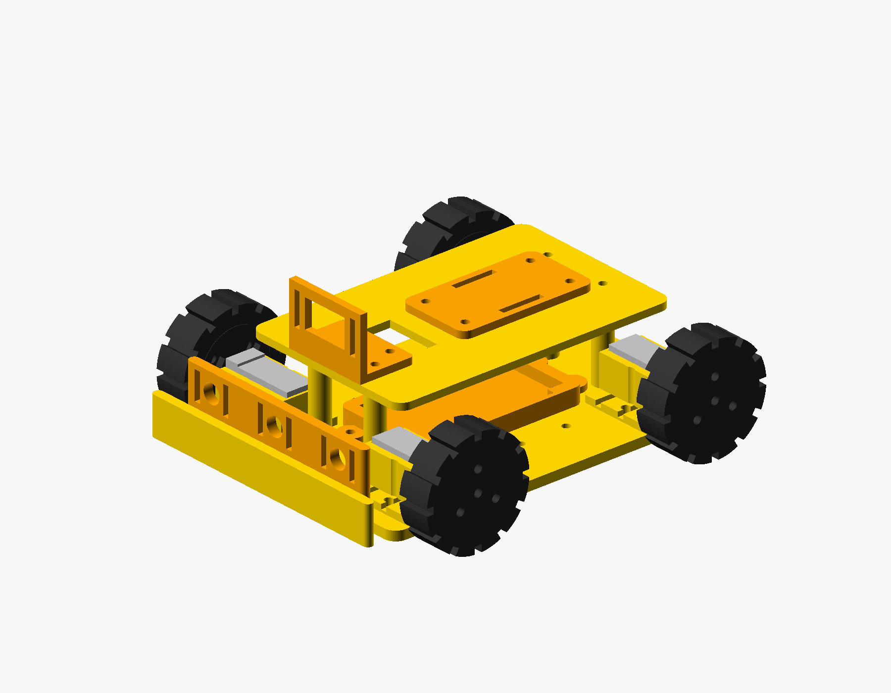

# Compact 4WD Smart Rover

**Project status:** CAD geometry audited; hardware fit, electronics integration and physical printing remain unverified  
**Document date:** 2026-10-09

## 1. Purpose

A compact, cute 4WD rover around **150 × 105 mm**, intended for indoor/tile and relatively smooth surfaces. The baseline uses four N20 geared motors, an ESP32-S3 camera/controller, three ToF sensors and phone control.



See the [CAD audit](audit/CAD_AUDIT.md) and [printing guide](audit/PRINT_GUIDE.md) for measured exports, corrections and release conditions. Root infographics are concept artwork, not manufacturing drawings.

## 2. Mechanical baseline

| Item | Target |
|---|---:|
| Chassis | 150 × 105 mm |
| Base thickness | 4 mm |
| Approx. chassis underside clearance | 5 mm |
| Wheels | 45 mm nominal diameter × 14 mm wide |
| Wheel adapter | 30 mm flange / 14 mm locating sleeve |
| Wheel/adapter bore | 3.4 mm / generic 3.25 mm, with headless radial M3 locking screw |
| Wheel centre Z | 17.5 mm above chassis underside; nominal ground Z=−5 |
| Upper deck | 120 × 76 × 3 mm |
| Deck Z | 38 mm underside / 41 mm top |
| Standoffs | 34 mm; shared (±50, ±14) mounting positions |

These match the audited default CAD. Overall modeled assembly is 164 × 137 × 71.949 mm; fasteners, actual PCBs, pack and wiring are omitted. **Exact N20 motor dimensions must be frozen before final motor brackets are released.**

## 3. Motors

**4 × N20 geared DC motors**, all matching voltage/gear ratio.

Baseline intentionally has **no encoders** to keep the first build simple. Encoders can be added later for odometry and closed-loop speed control.

## 4. Motor driver

**2 × DRV8833 dual H-bridge modules**, one driver handling two motors.

The exact N20 stall current must be checked against the chosen motor before purchase. Do not use DRV8833 for the larger JGB37-520 motors.

## 5. Controller

**ESP32-S3** handles:

- motor PWM/direction
- camera
- ToF sensors
- Wi-Fi/Bluetooth
- phone commands
- obstacle logic
- watchdog/failsafe

Suggested command set:

`FORWARD`, `BACKWARD`, `LEFT`, `RIGHT`, `STOP`, `SPEED`, `CAMERA_STREAM`, `AUTO_AVOID`.

A command timeout should stop the motors if communication is lost.

## 6. Sensors

**3 × VL53L0X ToF**

- front-left
- front-centre
- front-right

If multiple VL53L0X boards use the same I²C address, use XSHUT sequencing to assign unique addresses.

## 7. Battery/power

Initial baseline was **2S (7.4 V nominal) rechargeable battery**. Exact capacity and chemistry should be selected after the exact N20 motor is frozen.

```text
2S battery
   |
 fuse / switch
   +--> DRV8833 --> 4 × N20
   |
   +--> regulator --> ESP32-S3 + ToF + camera
```

Use a regulator with adequate current margin and keep motor wiring separated from sensitive sensor/camera wiring where practical.

## 8. CAD lessons

Earlier conceptual CAD had wheel-placement/assembly problems. The corrected process is:

1. Freeze exact N20 motor.
2. Measure gearbox and mounting pattern.
3. Freeze wheel bore/hub.
4. Check wheel/chassis interference.
5. Check ground clearance.
6. Check deck and camera clearance.
7. Check battery volume.
8. Print a motor/bracket fit test.
9. Then release final STL.

**Current individual meshes pass geometric checks; final manufacturing fit still requires the selected hardware and printer tests.**

## 9. Printable parts

- chassis
- four motor brackets
- four wheels/hubs
- upper deck
- standoffs
- camera mount
- one generic three-position ToF carrier
- battery tray
- power switch mount — unverified and not supplied in current CAD
- front bumper; decorative side covers are not supplied

PETG is the preferred general-purpose prototype material; PLA is acceptable for indoor prototypes and TPU can be used for bumpers/tyres.

## 10. Compact BOM

| Qty | Component | Specification / note |
|---:|---|---|
| 4 | N20 geared motors | Same voltage/gear ratio |
| 4 | Wheels | ~45 mm |
| 2 | DRV8833 | Dual H-bridge |
| 1 | ESP32-S3 camera board | Exact board to be frozen |
| 3 | VL53L0X | ToF |
| 1 | 2S battery | Capacity to be selected |
| 1 | Matching charger | Chemistry-specific |
| 1 | 5 V/logic regulator | Adequate current margin |
| 1 | Fuse | Size from measured current |
| 1 | Power switch | DC-rated |
| 1 set | Wiring/connectors | JST/XT30/etc. |
| 1 set | M2/M3 hardware | Nylon/metal as appropriate |
| 1 | Printed chassis set | PETG/PLA prototype |

## 11. Obstacle avoidance baseline

```text
if front < STOP_DISTANCE:
    stop
    turn toward the side with more free space
elif left < SIDE_THRESHOLD:
    steer right
elif right < SIDE_THRESHOLD:
    steer left
else:
    forward
```

This can later be replaced with a proper local planner.

## 12. Software

Prototype options:

- Arduino framework or ESP-IDF
- C/C++
- Wi-Fi HTTP/WebSocket
- I²C for ToF
- PWM for motors
- camera streaming
- watchdog

A web UI hosted by the ESP32-S3 can be used before building a dedicated mobile app.

## 13. Future upgrades

- encoder N20 motors
- IMU
- better ToF
- visual tracking
- AprilTags
- Raspberry Pi companion computer
- ROS 2
- autonomous navigation

## 14. Reference

The rugged rover uses the larger JGB37-520 encoder motor architecture described in the separate document.

