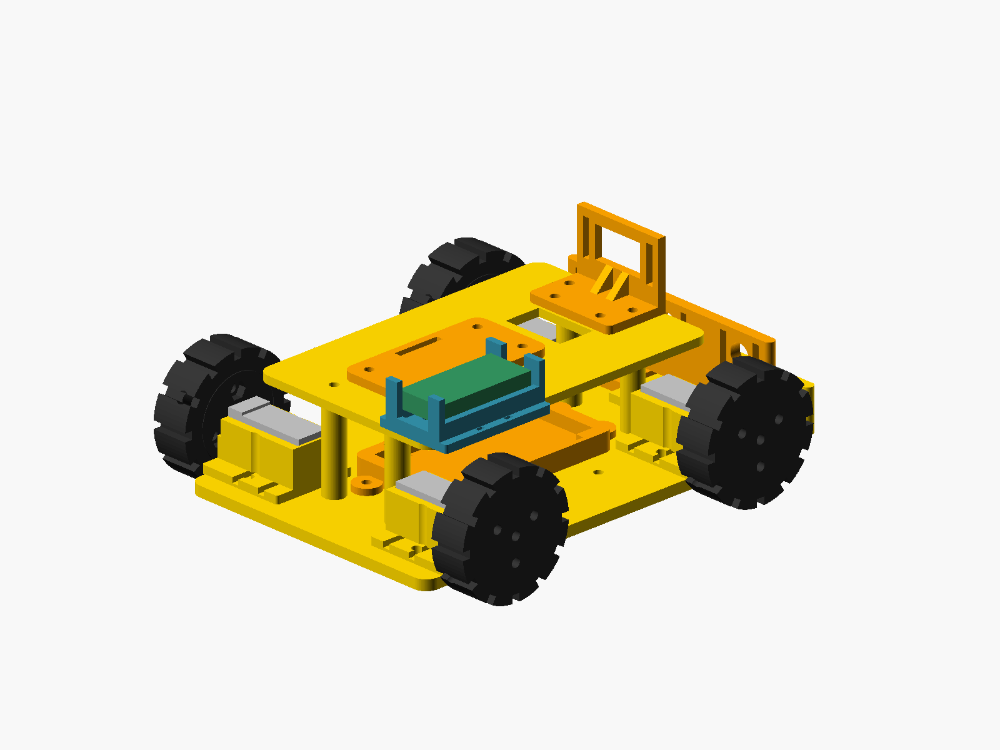

# USB-C charging for the compact 2S rover

Added 2026-10-10. Applies to `01_Cute_N20_4WD` and its 7.4 V nominal / 8.4 V full **2S Li-ion/LiPo** battery architecture.

## Recommended module

Use the [SoBotz 2S LiPo Type-C Charging Module, SBTZ00017](https://sobotz.com/en/product/charging-module/). The seller specifies a **39 × 18 × 6.3 mm** overall envelope and ships it configured for **2S, 8.4 V, approximately 0.55 A battery charge current**. Its “1 A” setting refers to input current, not battery current. Keep that supplied configuration; the final battery must permit this charge current. A 5 V USB supply rated for at least the module's 1 A input is needed. USB-C-to-C operation/CC resistors are not established by the listing: confirm with the actual module; a regulated 5 V USB-A supply and A-to-C cable is a practical initial bench setup. No PD voltage negotiation is assumed.

The [Robu listing](https://robu.in/product/2s-8-4v-2a-18650-lithium-battery-charger-module-type-c/) is a possible Indian sourcing alternative, but its accessible page did not establish the footprint/configuration. Do not assume it is an interchangeable part from the similar name or the “2A” URL. The CAD is sized to the SoBotz module; measure any substitute and change the parameters before printing. No module or battery has been purchased or physically verified.

This charger has **no cell balancing**. Use a professionally assembled 2S pack with per-cell protection and a documented balancing arrangement, sized for the rover's measured motor current. An unprotected RC pack from the earlier budget BOM is not sufficient for unattended built-in two-wire charging. Keep access to its balance lead if it needs a separate balance charger. This addition does not select a battery or certify the existing generic 62 × 32 mm tray for a purchased pack. Neither a TP4056 single-cell charger nor an 8.4 V module for a different chemistry is suitable here.

## CAD and printing



- [Carrier source](parts/usb_c_charger_mount.scad), [printable carrier STL](exports/usb_c_charger_mount.stl), and [carrier preview](exports/usb_c_charger_mount.png).
- Reprint the [upper deck](exports/top_cover.stl), which now has two matching Ø3.4 mm holes at **(27, 28.5)** and **(51, 28.5)**. Coordinates are mm from the chassis centre; front is −X.
- The cradle's centre is **X=39, Y=32.5**, with its floor at **Z=41** on the deck. USB-C faces **rearward (+X)**. The rear guard's outer face is **X=61.4**; the assumed connector centre is **Y=32.5, Z=50.5**.
- Carrier bounds are **44.8 × 29.8 × 17 mm**. The nominal board space has 0.5 mm clearance per edge, edge seats 7 mm above the carrier's underside, and 4 mm under-board space above the 3 mm floor.
- A **14 mm wide open-top rear notch** begins 5 mm above the carrier underside. It reserves a **14 × 8 × 30 mm** cable boot and rear insertion path. This deliberately oversized opening accommodates a plug through the guard; it is not a precision USB-C receptacle model. The board and plug envelope helpers are check-only and excluded from printable assembly geometry.
- Two M3×10 bolts, Ø6.6 × 3 mm maximum heads, and two M3 nuts (5.7 mm AF / 2.7 mm thick) attach the carrier to the deck. Fit the screws first; the PCB lifts out after its ties are released. The nominal head-to-board gap is 1 mm; washers or larger heads require a new stack check.
- Use two narrow insulated ties in the paired **2.8 × 1.4 mm** floor slots. Each slot pair connects through a **1.4 mm high underside channel**, so the installed deck does not block the tie. Select ties whose width/thickness fit those slots. Inspect the PCB and move `CHARGER_TIE_X` if a tie would press on components or exposed pads; isolate contact surfaces appropriately. No PCB drilling or invented PCB screw pattern is required.
- Print the carrier flat, floor down, in PETG. The wire exit and port notch are open above, so they have no bridge roofs. The two underside tie channels bridge 2.8 mm and leave 1.6 mm of floor above; inspect them in the slicer and first print. Inspect the short overhang beyond the deck and actual board edge seats in the first fit print.

The whole modeled rover remains 164 × 137 × 71.949 mm. The new cradle clears the modeled controller carrier, rear spacers, wheels and motors. Real boards, wiring, printer fit, connector setback and USB plug dimensions remain to be measured.

## Wiring and use

```text
regulated 5 V USB supply
    │ USB-C cable
    ▼
2S / 8.4 V boost charger
    │ BAT+ / BAT−
    ▼
protected 2S pack's approved CHARGE terminals
    │ approved DISCHARGE terminals
    ▼
main fuse → rover power switch → motor / logic regulators and loads
```

Follow the pack/BMS manufacturer's terminal diagram: common-port BMS normally uses its protected P+/P− terminals for charging, while a separate-port BMS may use C−. Do not bypass protection by connecting straight to cell terminals, and do not join a separate C− to P− to match this simplified diagram. Confirm polarity before connecting.

**Switch the rover off while charging.** This module has no documented system power path that allows reliable charge termination with running motor/controller loads. The charge branch must stay connected to the protected pack when the rover's load switch is off. Keep the board ventilated, verify temperature and both cell voltages during initial supervised charges, and follow the selected pack's charge limits. Fit and electrical bench checks are required before relying on built-in charging.

## Reproduce the geometric checks

```sh
/private/tmp/cute-cad-venv/bin/python audit/tooling/export_cad.py \
  --openscad /private/tmp/cute-OpenSCAD.app/Contents/MacOS/OpenSCAD --part-previews
/private/tmp/cute-cad-venv/bin/python audit/tooling/validate_cad.py
/private/tmp/cute-cad-venv/bin/python audit/tooling/check_charger_access.py
```

Run from this project's directory; the export tool may require the established sandbox exception for Qt's NEON detection. [Assembly validation](audit/validation_results.json) records printable topology and all placed-part interferences. [Charger checks](audit/charger_access_results.json) record the reserved module, rear plug insertion, vertical removal, ties and M3 hardware access. These validate geometry against declared envelopes, not charging performance or actual manufactured hardware.
