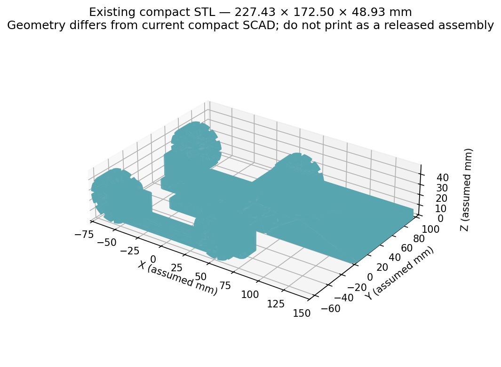
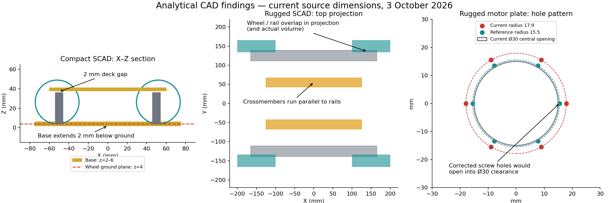

# Two rover projects — design review, component details and India buying guide

**Prepared 3 October 2026 (India). Budget instruction: below ₹15,000.** This report assumes that limit is per car and also gives a combined-budget route. Prices marked **live** came from public listing pages/product JSON during this review; all other numbers are spending allowances or explicitly labelled indexed snapshots. GST is included only where the seller states it; shipping, tools and external fabrication quotes are separate. Saved photo/listing metadata is in [component_sources.json](component_sources.json).

**Neither supplied design is ready for final manufacturing.** There are {{FINDING_COUNT}} documented findings across the two SCAD masters, their part wrappers, the one existing STL and the accompanying project documents. Fix the mounting, clearance, battery and wheel interfaces before final prints. The findings distinguish measured mesh defects, directly derived SCAD defects, integration gaps and unverified fit risks.

## Decision and budget

| Build | What you receive | Planning parts subtotal | Reserve | Planning total | Budget conclusion |
|---|---|---:|---:|---:|---|
| Compact N20 | Four N20 motors; rubber wheels; S3 motor/sensor controller; separate streaming camera; three ToF; battery/charger/printing/hardware | ₹{{COMPACT_TOTAL}} | ₹1,000 | **₹{{COMPACT_WITH_RESERVE}}** | Comfortably below ₹15,000 if you print yourself and source to the stated caps |
| Rugged budget | Four 12 V encoder motors; four BTS7960 channels requiring qualification; one ToF; metal frame; 3S battery/charger; S3 phone control | ₹{{RUGGED_BUDGET_TOTAL}} | ₹1,000 | **₹{{RUGGED_BUDGET_WITH_RESERVE}}** | Budget-first option; qualify driver modules and obtain motor/wheel/fabrication quotes |
| Rugged with genuine Cytron drivers | Same rover, with two MDD10A dual boards instead of four generic bridges | ₹{{RUGGED_TOTAL}} | ₹250 | **₹{{RUGGED_QUALITY_WITH_RESERVE}}** | Very tight: shipping/quotes can exceed ₹15,000; reduce cost or use budget option if they do |
| Rugged with original autonomy architecture | Above plus Pi, cooling, storage, proper mobile Pi supply, rotating LiDAR, IMU, camera and supports | Roughly another ₹25,000–30,000 in upgrade allowances | Actual shipping/fabrication | Typically around ₹40,000+ | Does not fit a new-parts ₹15,000 ceiling |

These are **complete planning lists, not guaranteed checkout quotes**. A single unavailable motor variant, outsourced print job or frame fabrication quote can change the total. The rugged budget build has **no Pi, no LiDAR and no ROS SLAM**. It preserves encoder wiring and a metal frame so those can be added later. Phone teleoperation and basic ToF stop logic are within its scope; grass/slope/payload capability remains to be tested.

The budget battery change is deliberate: original 4S LiFePO₄ 15 Ah is 192 Wh nominal, whereas the selected 3S LiPo 2.2 Ah is 24.42 Wh, about one eighth of that energy. If subsequent measurement gives a 20–40 W mean load, an illustrative 80% usable-energy assumption means 24.42 Wh would imply roughly 29–59 minutes. This is an estimate, not a runtime claim. At 60 RPM on 100 mm tyres the no-load geometric speed is 0.314 m/s (1.13 km/h); 90 mm tyres reduce that to 0.283 m/s. Compact 44 mm wheels at 100 RPM give 0.230 m/s no-load.

If ₹15,000 means **both cars combined**, target about **₹5,500 compact + ₹8,500 rugged**, keeping ₹900 shared reserve (₹14,900 combined target). This is a reduced prototype plan: share the charger, programmer and tools; omit compact video initially; use four BTS7960 modules requiring qualification instead of two Cytron boards for the rugged car; postpone all compute/LiDAR upgrades. It is conditional on actual local frame/printing and encoder-motor prices. If those caps fail, finish the compact rover first. Do not buy four incompatible cheaper motors just to satisfy a subtotal.

## What was actually checked

Read both master SCAD files, all **29 individual SCAD wrappers** (12 compact and 17 rugged), the two detailed project documents, READMEs, manifest and research notes. Inspected the existing assembled PNG. Parsed the **only supplied STL** directly, welded identical vertex coordinates, counted edge incidence and winding, zero-area and duplicate triangles, vertex-connected components and physical bounds. Calculated SCAD coordinate intervals and mating-hole patterns from source.

**OpenSCAD is not installed in this workspace.** No fresh F6/CGAL renders, source-to-STL Boolean comparison, slicer run, self-intersection test, FEA, physical fit test or load test was performed. Syntax/runtime validity of wrappers and SCAD defaults remains to be confirmed in OpenSCAD. The `.csg` file is a historical validation artefact; it does not certify manufacturability. Source files and existing STL were left unchanged; all new outputs are under `review/`.

### Existing STL measurements

| Check | Result | Meaning |
|---|---|---|
| File | `01_Cute_N20_4WD/cute_rover_complete.stl`, ASCII, 3,492,129 bytes | Existing historical full assembly |
| Triangles / unique vertices | 21,410 / 10,643 | Exact-coordinate welding |
| Bounds | X −77.4263 to 150; Y −67.5 to 105; Z 0 to 48.9263 | STL has no inherent unit metadata; mm assumed from source |
| Dimensions | **227.4263 × 172.5 × 48.9263 mm** | Does not match the current centred 150 mm chassis assembly |
| Boundary edges | 0 | Closed edge incidence alone does not guarantee a valid solid |
| Non-manifold edges | **1** | Four faces meet one edge: (−10,−16,24) to (10,−16,24) |
| Inconsistent orientation at two-face edges | 0 | Good locally; does not negate non-manifold edge |
| Zero-area / duplicate triangles | 0 / 0 | No such defects under exact-coordinate checks |
| Vertex-connected components | **5** | Does not equal a valid printable parts set; vertex/tangent contacts may join bodies |
| Signed mesh volume | 239,820.97 mm³ | Analytical metric only; do not treat as slicer filament estimate for this defective assembly |
| Current SCAD expected outer envelope | About 150 × 138 × 48 mm including motor placeholders; wheel/hub width about 133 mm | Source-based: base z=2..6, wheels z=4..49, camera up to z=50; therefore source Z extent is **48 mm** from z=2 to 50. Placeholder shaft tips extend Y to ±69. Not freshly rendered |

Re-run the audit with `python3 review/audit_stl.py`; raw results and component bounds are in [stl_metrics.json](stl_metrics.json). The STL SHA-256 is `d78348921ff9c3e0a4fbb2df4da57c51c3a032d2f0173866e0911068205e1e5f`.





The drawings above are computed diagnostics, not corrected CAD renders. They make the ground-clearance, disconnected-frame and motor-plate errors visible.

## Compact car bill of materials

This recommended budget configuration uses **two boards**: an ESP32-S3 DevKit controls the four motors and ToF sensors; a separate ESP32-CAM streams video. This is an explicit change from the original single S3-camera-board idea, made to avoid unverified camera/GPIO conflicts. The selected camera listing currently calls its sensor **OV3660**, even though some photos and old text show OV2640. Check the delivered module and firmware pin map. One S3 camera board can replace both only after its motor/I²C/XSHUT GPIO budget and power interfaces are verified.

{{COMPACT_BOM}}

**Compact subtotal: ₹{{COMPACT_TOTAL}}.** Every row is included once; optional encoder upgrades below replace the base motors. Tools and labour are excluded. Purchased rubber wheels replace both the SCAD wheels and hub adapters.

## Rugged car bill of materials

The table below uses the **higher-quality Cytron driver option**. For the budget-first build, substitute R05 with **four BTS7960/IBT-2 boards at a ₹350 per-board cap (₹1,400 total)** and add a **₹150 logic-interface kit**, reducing the subtotal to ₹{{RUGGED_BUDGET_TOTAL}}; the other rows stay the same. The substituted full list is [rugged_budget_bom.csv](rugged_budget_bom.csv), including R28: one 8-channel SN74AHCT245 carrier/IC on perfboard, 100 nF bypass, fixed direction/output-enable wiring and pull-downs. At 5 V, AHCT TTL input thresholds accept 3.3 V control and supply 5 V signals to the driver; verify the actual module's requirements. This buffer is MCU-to-driver only, separate from encoder downshift. RPWM/LPWM use two outputs per motor rather than Cytron PWM/DIR; hardware enables need a defined default-off stop path. [TI SN74AHCT245](https://www.ti.com/product/SN74AHCT245)

Both options use four individual encoder motor channels. **Two MDD10A boards provide four channels, not eight**. Do not connect both motors of a side to one bridge if you intend to control all four speeds independently. Keep a common logic reference, eight verified A/B encoder signal inputs and a hardware stop path. The Pololu motor photo below is a **premium reference/alternative**, not the budget JGB37 motor; a live photo of the EngineersToy listing could not be retrieved.

{{RUGGED_BOM}}

**Rugged Cytron subtotal: ₹{{RUGGED_TOTAL}}; budget-driver subtotal: ₹{{RUGGED_BUDGET_TOTAL}}.** No external bearing parts or Pi/LiDAR purchases are silently included. If a matched wheel includes its locking hub, remove R03 to save ₹400; check engagement and retention first. If paid printing/fabrication pushes the price above the ceiling, reduce nonessential body panels and buy quotes before motors in bulk. Printing allocation assumes trays are redesigned with thinner floors/ribs rather than printing the current thick solid plates; slice the corrected set and adjust material cost before checkout.

## Original architecture and optional upgrade inventory

These items complete the original documented architecture and useful future options. They are **excluded from both base subtotals**. Select one battery chemistry and one corresponding charger system; do not sum mutually exclusive batteries or replacement motors. Four-motor external bearing support is a mechanical redesign, not a plug-in addition.

{{OPTIONAL_BOM}}

### Important rejected or conditional battery alternatives

The [WATTNINE 12.8 V 6 Ah listing](https://quartzcomponents.com/products/12v-6ah-lithium-battery-lifepo4-battery) shows about ₹1,880 in live product JSON and explicitly specifies **6 A continuous discharge** with integrated protection. That is insufficient for an unrestricted four-motor build whose simultaneous starts/stalls can exceed it. Its stated 14.4 V charging requirement also conflicts with the suggested 14.6 V charger; resolve with the manufacturer. It is not the default substitute in this BOM.

The [ELBOTICS 12.8 V 6 Ah candidate](https://elbotics.com/products/12-8v-6ah-lifepo4-battery-smart-bms-76-8wh) shows ₹1,699 and a built-in BMS, but the accessible specifications do not establish continuous/peak discharge, precise dimensions or a complete protection specification. It also contains inconsistent capacity/chemistry fields. It remains **purchase pending specifications**, even though its price is attractive.

The original [15 Ah Robu LiFePO₄ pack](https://robu.in/product/4s1p-lifepo4-battery-pack/) has an indexed category price near ₹3,519; the live product body could not be read. Do not infer an included BMS from the title. Four 32140 cells imply a cell-length scale of approximately 140 mm; a linear arrangement or packaging may not fit the CAD's 200×80 cavity in the assumed orientation. Require the complete pack drawing and weight.

## Component photos

Actual supplier/manufacturer images are saved locally and attributed below. Photos help identify the part family; they do not prove the delivered variant or mechanical fit. International reference products are not priced as Indian budget parts. Image-source URLs and timestamps are preserved in the metadata file.

{{GALLERY}}

## Fabrication and printed component inventory

All named mechanical modules are accounted for, including inactive modules and optional parts. Quantities represent pieces, **not export-file count**. `assembly` wrappers are visualization/export helpers and are not physical components. Camera, sensor, regulator, driver, switch and power-distribution brackets missing from the current CAD must be designed as part of final integration.

{{INVENTORY}}

Use PETG for general chassis/module prototypes, TPU for optional tyres/bumpers, and aluminium for the rugged primary structure. ASA needs a suitable printer/enclosure. The initial document's 0.2 mm layers, 5 perimeters and 35–50% infill are only starting settings; mounting strength depends on orientation and load path. Reserve material for fit coupons. Long 330 mm rails/bumper parts exceed many 220 mm print beds, so fabricate structural rails in metal and segment optional bumpers with real joining features if necessary. The rugged overall envelope is about **400×332 mm**, larger than its intended structural footprint; choose printer/fabrication from individual part sizes.

## CAD findings

Read all blockers before purchasing mount-specific parts. Each entry gives a source location, observation and correction; CSV contains the same findings for tracking. Source links are relative to this local report; the `:line` label identifies the exact source even if your browser does not scroll to `#L` fragments in local SCAD files.

### Compact SCAD findings

{{COMPACT_FINDINGS}}

### Rugged SCAD findings

{{RUGGED_FINDINGS}}

### STL, electrical and documentation findings

{{SHARED_FINDINGS}}

## Compatibility details to freeze before ordering

### Motor, hub, wheel and frame

For **each motor SKU**, collect rated voltage, no-load/loaded RPM, reduction ratio, usable continuous torque, stall current at selected voltage, gearbox and can L/W/H, face PCD/pilot, shaft diameter/flat-depth/length, any shaft eccentricity, encoder board/cap and lead exits. A family name is not a manufacturing drawing. The Pololu drawing's 15.5 mm adjacent mounting spacing implies **R=15.5 mm for a regular six-hole hexagon**; `R=17.9` is wrong. The reference requires no more than 3 mm screw penetration into gearbox holes. Do not generalise that depth to a different vendor without its drawing. [Pololu mechanical drawing](https://www.pololu.com/file/0J1735/37d-metal-gearmotors-dimension-diagram.pdf)

For each wheel, require diameter, width, hub depth, axle bore shape/flat, offset, bolt pattern and fastening method. Compute **shaft engagement after bracket, pilot and hub placement**, then choose wheel Y from that mating geometry. Prefer metal locking hubs for the rugged car. A round printed clearance hole needs a separate torque and axial locking mechanism. Check tyre runout, rim clearance, full-rotation clearance, bolt-head clearance and motor wire clearance. Match mass/radial-load limits before adding bearings.

### Drivers, voltage and protected power

DRV8833 supports 2.7–10.8 V operating supply, but chip package ratings differ: the thermally enhanced packages support 1.5 A RMS/2 A peak per bridge under stated conditions; the PW package is 500 mA RMS. A carrier's thermal capability may be lower. Treat a seller's “2 A” as a peak claim until demonstrated. [TI DRV8833](https://www.ti.com/product/DRV8833)

The genuine MDD10A Rev2 supports 5–30 V, **10 A continuous and 30 A peak for 10 seconds per channel**, 3.3/5 V control and regenerative braking; it has no motor-supply reverse-polarity protection. A “13 A” seller sentence does not override the manufacturer. [Cytron MDD10A](https://www.cytron.io/p-10amp-5v-30v-dc-motor-driver-2-channels)

An alternative **four BTS7960/IBT-2 boards** costs less but uses one board per motor, takes more space and requires inspection of PCB terminals, logic buffers, heatsink and current-sense implementation. “43 A” in a module title is not a demonstrated continuous board current. Start with a conservative tested current and use enable pull-downs. It does not provide closed-loop encoder control by itself. [Robokits listing route](https://robokits.co.in/index.php?main_page=product_info&products_id=1859) has an indexed ₹307/in-stock snapshot; [Robocraze's alternative](https://robocraze.com/products/bts7960b-43a-h-bridge-motor-driver) has an indexed ₹316 but is sold out. Verify checkout GST and stock before using the ₹350 cap.

If the budget JGB37 encoder motor cannot be obtained, [Robokits RMCS-3012](https://robokits.co.in/motors/encoder-dc-servo/high-torque-12v-dc-encoder-motor/dc-12v-60rpm-high-torque-quad-encoder-motor) is a documented 12 V 60 RPM quadrature alternative, indexed at ₹1,500 each. Its 37 mm gearbox, offset 6 mm shaft, 30 mm shaft length, 87 mm body and 5 V encoder require new brackets/level conversion; advertised load current is up to 7.5 A, so redo stall/driver/fuse checks. Availability snapshots conflict between in stock and 45-day shipment. Four add at least ₹3,400 over the motor allowance and exceed the budget configuration. The [Rhino GB37 nonencoder alternative](https://robokits.co.in/motors/rhino-gb37-12v-dc-geared-motor/dc-geared-12v-motors/rhino-gb37-12v-60rpm-10.4kgcm-dc-geared-motor), indexed around ₹382, is the cheaper trade-off; it drops encoder speed control/odometry rather than retaining the full feature set.

Size motor branches from **measured and maker-specified stall/start current**, not nominal running current. For illustration only, the manufacturer-indexed JGB37-520B 12 V 60 RPM table reports about 2.3 A stall for one variant; all four would be 9.2 A at 12 V. That is not the confirmed EngineersToy motor. A Pololu #4755 instead lists 5.5 A per motor, so four would be 22 A. Driver, BMS, fuse, connectors and gauge must change accordingly. [JGB37 manufacturer reference](https://www.aslongdcmotor.com/photo/aslongdcmotor/document/26547/37mm%20Round%20Spur%20Gear%20Motor_PDF00.pdf), [Pololu alternative](https://www.pololu.com/product/4755)

Suggested initial power routes:

```text
COMPACT: 2S LiPo → fuse → DC main switch → distribution
           ├─ motor regulator 5.5–6 V + tested braking clamp → two DRV8833 → four N20
           └─ filtered 5 V regulator → S3 DevKit + camera board
                                        └─ 3.3 V-compatible ToF bus

RUGGED BUDGET: 3S LiPo → fuse → battery disconnect → distribution
                ├─ hardware drive-stop path → two MDD10A → four JGB motors
                └─ filtered 5 V regulator → S3 + verified encoder interface + ToF
                     └─ optional separate qualified Pi supply added later
```

Connect battery/motor returns at power distribution; keep sensor/encoder returns clear of motor current. Use reverse-polarity protection or a keyed checked harness. Do not place a single flyback diode directly across a bidirectional motor. Braking energy needs a return path; ordinary buck regulators often cannot sink current. Check rail overshoot, especially with a full battery or a BMS that disconnects. Suppression component values in the BOM are starting allocations, not a validated transient circuit.

### Controller and GPIO budget

| Function | Compact recommended two-board build | Rugged four-channel build |
|---|---:|---:|
| Motor controls | 8 GPIO for two-input DRV8833 control per motor | 8 GPIO for PWM + DIR per motor |
| Encoder inputs | 0 base; +8 if encoder upgrade | 8 |
| Sensor bus | 2 GPIO I²C | 2 GPIO I²C |
| XSHUT | 3 GPIO for three ToF | 0 required for one; 3 if expanded to three |
| Disable/stop monitor | At least 1, tied to defined hardware stop path | At least 1; more if driver/circuit requires |
| Battery sensing | 1 ADC-capable input for suitable divider or external monitor | 1 ADC-capable input or external cell monitor |
| Camera | Own separate camera board; no control GPIO consumed by camera on S3 | Upgrade camera on own board/Pi; exclude camera bus from motor pins |
| Pi link later | Optional | USB or UART pins planned; native USB reserves its pins |

The compact S3 needs about **14 general inputs/outputs plus one ADC**, the rugged base about **19 plus one ADC**. Those are resource budgets, not tested pin assignments. Check exact module flash/PSRAM occupied pins, USB pins, strapping pins and onboard LED. Use pull-downs on drive-enable/PWM so reset and boot cannot move wheels. The advertised 7Semi board exposes headers; the selected variant still needs a pinout review. [Espressif DevKit guide](https://docs.espressif.com/projects/esp-dev-kits/en/latest/esp32s3/esp32-s3-devkitc-1/user_guide_v1.1.html)

A Seeed XIAO S3 Sense has camera, microphone and SD functions that reserve/share pins. With camera streaming plus four independent DRV8833 channels, I²C and three XSHUT lines, a direct pin allocation is tight; use an I/O expander for static XSHUT or separate control board, and disable conflicting SD/microphone functions as needed. An I/O expander should not carry timing-critical motor PWM or quadrature signals. [Seeed pin map](https://wiki.seeedstudio.com/xiao_esp32s3_getting_started/)

### Encoders and sensors

For encoder wiring, require the actual motor's six-or-other-wire pinout. The JGB manufacturer example's **11 pulses/signals per motor revolution does not mean 11 wires**. If PPR=11 per channel, quadrature x4 and reduction=168, output counts are `11×4×168=7392`, only if those definitions and ratio match your unit. Rotate the wheel through one revolution and verify counts, direction and noise. Do not reuse Pololu's 64 CPR definition on a JGB motor. Use ESP32-S3 PCNT where appropriate and calibrate for the skid-steer effective track/slip. [Espressif PCNT](https://docs.espressif.com/projects/esp-idf/en/stable/esp32s3/api-reference/peripherals/pcnt.html)

The Pololu alternative needs encoder Vcc at least 3.5 V and produces outputs approximately up to Vcc, so 5 V encoder power requires a suitable 3.3 V input interface. For JGB variants, obtain the voltage/output type before wiring; do not infer pin colours across brands. Eight channels need eight conversions if outputs are push-pull 5 V. Establish common reference and route A/B away from motor leads.

VL53L0X uses I²C and programmable address with XSHUT. Three identical modules start at the same address; hold all off, enable/address one at a time, and repeat after every reset. Breakout board regulator/pull-ups matter: a bare sensor is not a 5 V module. Mount optics facing forward, angle side boards deliberately, and test in sunlight, on black surfaces and near shiny/transparent objects. Do not promise 2 m usable distance in every condition. [ST VL53L0X](https://www.st.com/en/imaging-and-photonics-solutions/vl53l0x.html)

### Pi/LiDAR upgrade

A Pi 5 should have a qualified mobile supply capable of its workload and USB peripherals. A 3 A supply can boot it but peripheral USB power is restricted; detecting a suitable 5 A supply raises the USB budget. A generic 5 A buck and passive USB-C lead do not automatically provide the correct supply negotiation. Include cooler, reliable storage, M2.5 carrier, proper Pi 5 camera cable, USB data cable and power scheme. [Official Pi power documentation](https://www.raspberrypi.com/documentation/computers/raspberry-pi.html#power-supply)

For LiDAR, confirm exact model revision, scan range/rate, Linux driver, USB interface, rated supply/current, footprint and height. Keep scan plane clear of Pi box, mast, camera and handles. RPLIDAR A1 is primarily a low-cost indoor mapping option; rugged outdoor use needs actual sunlight/terrain tests or a suitable outdoor-rated scanner. Validate IMU timestamps/calibration and four-wheel odometry before SLAM/Nav2. Defer model-specific software versions until the hardware/OS choice is frozen.

## Buying sequence and acceptance checks

1. **Fix geometry constraints first:** choose X front, Z ground/base convention, actual wheel/shaft alignment, battery floor and frame joints; add supported decks. Keep originals and make a reviewed revision.
2. **Buy one drivetrain sample per car:** motor, compatible wheel/hub and bracket. If seller cannot provide stall current, mounting drawing, encoder pinout and package contents, choose another supplier. Test motor dimensions before buying all four.
3. **Obtain pack and fabrication quotes:** exact battery drawing/current/BMS/connector, correct charger, printed part service if no printer, aluminium cut lengths/section and hole drawing. Keep a reserve inside ₹15,000.
4. **Print fit coupons:** rectangular motor cavity, shaft D bore/metal hub pocket, one motor bracket, one PCB mount, bolt/insert and optional bearing seats. Measure before final quantity printing.
5. **Render every individual part in OpenSCAD F6:** no warnings/undefined variables/empty geometry; no coplanar-only joints; slicer dimension/unit/orientation sanity check; manifold per-part STLs with source revision/hash.
6. **Bench-test power one motor at a time:** current-limited supply, polarity, 5 V stability, logic levels, current/temperature and brief controlled start-current checks. Avoid prolonged stalls. Verify all-four starts and worst skid turns within branch/fuse/BMS ratings.
7. **Test failsafe before wheels on ground:** boot/reset/offline command/USB disconnect must disable movement; per-cell low-voltage stop, emergency drive disable and recovery must work. Physical stop must work independently of Wi-Fi.
8. **Validate mechanical and terrain:** wheel spin clear of rails/bumper, no harness rub, pack restrained, all fasteners locked, no PCB contact with metal. Start unloaded on tile; then intended mass, grass and specified slope while logging current, temperature and wheel slip.

For slope sizing, set total mass `m`, wheel radius `r`, angle `θ` and estimated rolling resistance `Crr`. A first traction force is `F=m·g·(sinθ+Crr·cosθ)`. If four wheels share load, each needs at least `F·r/4` torque before drivetrain losses and acceleration/turning margin. Use **continuous rated torque**, not seller stall torque, for sustained hills. Centre-of-gravity height and track/wheelbase determine tipping; skid turns can need more current than straight driving.

Recommended tools already owned or acquired separately: digital caliper, multimeter, suitable current-limited bench supply/current meter, soldering iron, connector crimper or precrimped leads, hex drivers and drill/reamer for metal. Add their actual cost if purchasing them; neither car subtotal includes a printer, tools, computer or labour.

## Files and sources

The main reading version is [ROVER_REVIEW_AND_BOM.html](ROVER_REVIEW_AND_BOM.html); it includes offline photos, filterable tables and print-to-PDF support. The plain version is [ROVER_REVIEW_AND_BOM.md](ROVER_REVIEW_AND_BOM.md). Download [bom.csv](bom.csv), [design_findings.csv](design_findings.csv) and [fabrication_inventory.csv](fabrication_inventory.csv) for editing.

Buying links in each BOM row are direct product pages when verified, or **portal search routes** for generic hardware when a specific SKU is not frozen. Robu, Robocraze, Evelta, Zbotic, KitsGuru, Robokits and specialist hobby sellers are sourcing options, not endorsements of every listing. Mouser India / element14 India are alternative routes for genuine semiconductor/dev-board parts but usually cost more than generic module sellers. For aluminium and metric hardware, local fabrication/fastener shops can be cheaper and allow measuring before purchase.

Stock changed or conflicted between indexed pages and live JSON during this check. N20 Robocraze ₹225 is unavailable; camera JSON said available while cached page said sold out; VL53L0X JSON ₹126 differs from cached ₹123. All matching quantities/variants must be checked at checkout. No purchases were made.
