# Two rover projects — design review, component details and India buying guide

**Prepared 3 October 2026 (India). Budget instruction: below ₹15,000.** This report assumes that limit is per car and also gives a combined-budget route. Prices marked **live** came from public listing pages/product JSON during this review; all other numbers are spending allowances or explicitly labelled indexed snapshots. GST is included only where the seller states it; shipping, tools and external fabrication quotes are separate. Saved photo/listing metadata is in [component_sources.json](component_sources.json).

**Neither supplied design is ready for final manufacturing.** There are 58 documented findings across the two SCAD masters, their part wrappers, the one existing STL and the accompanying project documents. Fix the mounting, clearance, battery and wheel interfaces before final prints. The findings distinguish measured mesh defects, directly derived SCAD defects, integration gaps and unverified fit risks.

## Decision and budget

| Build | What you receive | Planning parts subtotal | Reserve | Planning total | Budget conclusion |
|---|---|---:|---:|---:|---|
| Compact N20 | Four N20 motors; rubber wheels; S3 motor/sensor controller; separate streaming camera; three ToF; battery/charger/printing/hardware | ₹7,602.00 | ₹1,000 | **₹8,602.00** | Comfortably below ₹15,000 if you print yourself and source to the stated caps |
| Rugged budget | Four 12 V encoder motors; four BTS7960 channels requiring qualification; one ToF; metal frame; 3S battery/charger; S3 phone control | ₹12,476.00 | ₹1,000 | **₹13,476.00** | Budget-first option; qualify driver modules and obtain motor/wheel/fabrication quotes |
| Rugged with genuine Cytron drivers | Same rover, with two MDD10A dual boards instead of four generic bridges | ₹14,699.64 | ₹250 | **₹14,949.64** | Very tight: shipping/quotes can exceed ₹15,000; reduce cost or use budget option if they do |
| Rugged with original autonomy architecture | Above plus Pi, cooling, storage, proper mobile Pi supply, rotating LiDAR, IMU, camera and supports | Roughly another ₹25,000–30,000 in upgrade allowances | Actual shipping/fabrication | Typically around ₹40,000+ | Does not fit a new-parts ₹15,000 ceiling |

These are **complete planning lists, not guaranteed checkout quotes**. A single unavailable motor variant, outsourced print job or frame fabrication quote can change the total. The rugged budget build has **no Pi, no LiDAR and no ROS SLAM**. It preserves encoder wiring and a metal frame so those can be added later. Phone teleoperation and basic ToF stop logic are within its scope; grass/slope/payload capability remains to be tested.

The budget battery change is deliberate: original 4S LiFePO₄ 15 Ah is 192 Wh nominal, whereas the selected 3S LiPo 2.2 Ah is 24.42 Wh, about one eighth of that energy. If subsequent measurement gives a 20–40 W mean load, an illustrative 80% usable-energy assumption means 24.42 Wh would imply roughly 29–59 minutes. This is an estimate, not a runtime claim. At 60 RPM on 100 mm tyres the no-load geometric speed is 0.314 m/s (1.13 km/h); 90 mm tyres reduce that to 0.283 m/s. Compact 44 mm wheels at 100 RPM give 0.230 m/s no-load.

If ₹15,000 means **both cars combined**, target about **₹5,500 compact + ₹8,500 rugged**, keeping ₹900 shared reserve (₹14,900 combined target). This is a reduced prototype plan: share the charger, programmer and tools; omit compact video initially; use four BTS7960 modules requiring qualification instead of two Cytron boards for the rugged car; postpone all compute/LiDAR upgrades. It is conditional on actual local frame/printing and encoder-motor prices. If those caps fail, finish the compact rover first. Do not buy four incompatible cheaper motors just to satisfy a subtotal.

## What was actually checked

Read both master SCAD files, all **29 individual SCAD wrappers** (12 compact and 17 rugged), the two detailed project documents, READMEs, manifest and research notes. Inspected the existing assembled PNG. Parsed the **only supplied STL** directly, welded identical vertex coordinates, counted edge incidence and winding, zero-area and duplicate triangles, vertex-connected components and physical bounds. Calculated SCAD coordinate intervals and mating-hole patterns from source.

**OpenSCAD is not installed in this workspace.** No fresh F6/CGAL renders, source-to-STL Boolean comparison, slicer run, self-intersection test, FEA, physical fit test or load test was performed. Syntax/runtime validity of wrappers and SCAD defaults remains to be confirmed in OpenSCAD. The `.csg` file is a historical validation artefact; it does not certify manufacturability. Source files and existing STL were left unchanged; all new outputs are under `review/`.

### Existing STL measurements

| Check | Result | Meaning |
|---|---|---|
| File | `01_Cute_N20_4WD/cute_rover_complete.stl`, ASCII, 3,492,129 bytes | Existing historical full assembly |
| Triangles / unique vertices | 21,410 / 10,643 | Exact-coordinate welding |
| Bounds | X −77.4263 to 150; Y −67.5 to 105; Z 0 to 48.9263 | STL has no inherent unit metadata; mm assumed from source |
| Dimensions | **227.4263 × 172.5 × 48.9263 mm** | Does not match the current centred 150 mm chassis assembly |
| Boundary edges | 0 | Closed edge incidence alone does not guarantee a valid solid |
| Non-manifold edges | **1** | Four faces meet one edge: (−10,−16,24) to (10,−16,24) |
| Inconsistent orientation at two-face edges | 0 | Good locally; does not negate non-manifold edge |
| Zero-area / duplicate triangles | 0 / 0 | No such defects under exact-coordinate checks |
| Vertex-connected components | **5** | Does not equal a valid printable parts set; vertex/tangent contacts may join bodies |
| Signed mesh volume | 239,820.97 mm³ | Analytical metric only; do not treat as slicer filament estimate for this defective assembly |
| Current SCAD expected outer envelope | About 150 × 138 × 48 mm including motor placeholders; wheel/hub width about 133 mm | Source-based: base z=2..6, wheels z=4..49, camera up to z=50; therefore source Z extent is **48 mm** from z=2 to 50. Placeholder shaft tips extend Y to ±69. Not freshly rendered |

Re-run the audit with `python3 review/audit_stl.py`; raw results and component bounds are in [stl_metrics.json](stl_metrics.json). The STL SHA-256 is `d78348921ff9c3e0a4fbb2df4da57c51c3a032d2f0173866e0911068205e1e5f`.


The drawings above are computed diagnostics, not corrected CAD renders. They make the ground-clearance, disconnected-frame and motor-plate errors visible.

## Compact car bill of materials

This recommended budget configuration uses **two boards**: an ESP32-S3 DevKit controls the four motors and ToF sensors; a separate ESP32-CAM streams video. This is an explicit change from the original single S3-camera-board idea, made to avoid unverified camera/GPIO conflicts. The selected camera listing currently calls its sensor **OV3660**, even though some photos and old text show OV2640. Check the delivered module and firmware pin map. One S3 camera board can replace both only after its motor/I²C/XSHUT GPIO budget and power interfaces are verified.

| ID / Qty | Component and required specification | Unit / line ₹ | Buy source / price evidence | Best alternative and fit implications |
|---|---|---:|---|---|
| C01 / **4** | **N20 gearmotor** — 6 V, 100 RPM target, 3 mm D shaft; all four identical | 300.00 / **1,200.00** | [Buy / inspect](https://robu.in/product-category/dc-motors/motors/n20-gear-motor/micro-gear-motor-without-encoder/); Estimate / spending cap | Same N20 6 V 60 RPM: slower, greater reduction; encoder version if odometry needed; [Alternative portal](https://robocraze.com/products/n20-6v-60-rpm-micro-metal-gear-box-dc-motor). **Fit/check:** Buy one first: gearbox length, 12×10 body, shaft length/flat, stall current. Robocraze ₹225 listing is unavailable; ₹300 cap uses a different seller. Mount redesign required. |
| C02 / **4** | **Rubber wheel** — 44–45 mm diameter; 3 mm D shaft; width/offset measured | 35.00 / **140.00** | [Buy / inspect](https://kitsguru.com/products/car-wheel-tyre-44mm-n20-dc-gear-motor-wheel); Live product JSON ₹35; available | 42 mm N20 wheel, or TPU tyre on redesigned D-hub; [Alternative portal](https://techdepot.in/products/n20-dc-gear-motor-wheel-42mm). **Fit/check:** ₹35 each listing; confirm whether one or pair. Set WHEEL_D to actual 44 mm; bought wheel replaces printed wheel AND separate adapter. |
| C03 / **2** | **DRV8833 dual driver** — One bridge per motor, four independent channels; 3.3 V input | 72.00 / **144.00** | [Buy / inspect](https://robocraze.com/products/drv8833-2-channel-dc-motor-driver); Live ₹72; available | Same DRV8833 at Zbotic; TB6612FNG only after stall/thermal check; [Alternative portal](https://zbotic.in/product/drv8833-2-channel-dc-motor-driver/). **Fit/check:** Choose real chip/carrier; full-current TI package differs from 500 mA PW package. Budget module seller claims 1.2 A; prove thermal margin. Fit new mounting holes. |
| C04 / **1** | **ESP32-S3 DevKit controller** — Header-equipped PCB-antenna DevKitC-compatible; USB; 3.3 V GPIO | 911.00 / **911.00** | [Buy / inspect](https://evelta.com/7semi-esp32-s3-devkitc-1-esp32-s3-wroom-wi-fi-bluetooth-5-ble-development-board/); Page headline ₹910.96 rounded; variant confirmation | WROOM-32 DevKit for control only; confirm available pins/firmware; [Alternative portal](https://robu.in/?s=ESP32+DevKit&post_type=product). **Fit/check:** Evelta headline ₹910.96 incl GST; selectable board variants differ. Advertised 64×25 mm board is too long for current 58×32 tray. Use a carrier cradle. |
| C05 / **1** | **Separate camera board** — ESP32-CAM with included OV3660; 5 V board input; Wi-Fi stream | 689.00 / **689.00** | [Buy / inspect](https://robocraze.com/products/esp32-camera-module); Live JSON ₹689; stock conflicts with cached page | Seeed XIAO ESP32-S3 Sense camera board; [Alternative portal](https://robu.in/?s=XIAO+ESP32S3+Sense&post_type=product). **Fit/check:** Intentional two-board budget architecture: S3 controls motors, camera streams independently. JSON says available; web snapshot says sold out. Confirm checkout and exact sensor pin map; CAM is classic ESP32, not S3. |
| C06 / **1** | **Camera programmer** — USB-UART with 3.3 V signal levels or matching ESP32-CAM-MB base | 150.00 / **150.00** | [Buy / inspect](https://robu.in/?s=ESP32+CAM+MB&post_type=product); Estimate / spending cap | Existing USB-UART adapter with verified 3.3 V TX/RX; [Alternative portal](https://robu.in/?s=CP2102+USB+UART&post_type=product). **Fit/check:** Needed if camera has no USB; its board needs adequate 5 V power, not a weak 3.3 V UART regulator. |
| C07 / **3** | **VL53L0X breakout** — I²C, exposed XSHUT; 3.3 V-safe bus and regulator-compatible input | 126.00 / **378.00** | [Buy / inspect](https://robocraze.com/products/vl53l0x-laser-ranging-sensor); Live JSON ₹126; available; web snapshot ₹123 | Same VL53L0X breakout at another seller; VL53L1X with firmware/bracket change; [Alternative portal](https://robu.in/?s=VL53L0X&post_type=product). **Fit/check:** Default 7-bit address 0x29; initialize separately to e.g. 0x30/31/32. Buy actual breakout, not bare sensor. Three independent bracket angles. |
| C08 / **1** | **2S LiPo battery** — 7.4 V nominal / 8.4 V full; ~850–1000 mAh; ≥10 A verified discharge | 900.00 / **900.00** | [Buy / inspect](https://robu.in/product/pro-range-1000mah-2s-30c60c-lithium-polymer-battery-pack-lipo/); Estimate / spending cap | 2S 850 mAh GNB/CNHL from hobby supplier; [Alternative portal](https://techhobby.in/product/cnhl-ministar-850mah-7-4v-2s-70c-lipo-battery-with-xt30u). **Fit/check:** PRICE/stock/dimensions unverified. Original 62×32 opening has no floor and is probably too shallow. Obtain L/W/H and connector exits before tray redesign. |
| C09 / **1** | **LiPo balance charger** — 2S-capable 4.20 V/cell; mains input or include required adapter | 450.00 / **450.00** | [Buy / inspect](https://robocraze.com/collections/battery-chargers); Estimate / spending cap | Genuine SkyRC B6neo plus required power source; [Alternative portal](https://robu.in/?s=SkyRC+B6neo&post_type=product). **Fit/check:** B3 is a lower-cost 2S/3S option (~₹332 category snapshot); verify quality/cell current. TP4056 is single-cell and cannot charge this pack. |
| C10 / **1** | **Motor buck regulator** — 2S → 5.5–6.0 V; ≥5 A continuous demonstrated at selected input | 400.00 / **400.00** | [Buy / inspect](https://robu.in/?s=5A+adjustable+buck+converter&post_type=product); Estimate / spending cap | Two adequately rated 3 A motor regulators, one per side; [Alternative portal](https://robu.in/?s=3A+buck+regulator&post_type=product). **Fit/check:** Prevents full 8.4 V from reaching 6 V motors. Must handle four starts and braking energy; choose converter/TVS clamp arrangement after tests; LM2596 labelled 3 A is not a proven 5 A solution. |
| C11 / **1** | **Logic buck regulator** — 2S → 5.0 V; ≥2 A continuous, low ripple | 150.00 / **150.00** | [Buy / inspect](https://robu.in/?s=5V+3A+buck+converter&post_type=product); Estimate / spending cap | Quality 5 V 2–3 A BEC; [Alternative portal](https://robu.in/?s=5V+BEC&post_type=product). **Fit/check:** Separate motor and logic branches. 5 V goes to board input, not GPIO; sensor input per breakout schematic. |
| C12 / **1** | **Low-voltage monitor/cutoff** — 2S cell monitor plus firmware stop; hardware cutoff if unattended | 100.00 / **100.00** | [Buy / inspect](https://robu.in/?s=1S+8S+lipo+battery+low+voltage+alarm&post_type=product); Estimate / spending cap | Protected high-discharge 2S Li-ion pack with appropriate BMS; [Alternative portal](https://robu.in/?s=2S+battery+BMS&post_type=product). **Fit/check:** Alarm alone does not disconnect load. Use ADC divider/cell monitor and test disconnect behaviour; confirm per-cell thresholds with pack maker. |
| C13 / **1** | **Fuse and holder kit** — DC fuse close to battery; spare fuse; provisionally 5 A | 100.00 / **100.00** | [Buy / inspect](https://robu.in/?s=inline+fuse+holder&post_type=product); Estimate / spending cap | Blade fuse holder from auto electrical shop; [Alternative portal](https://robu.in/?s=blade+fuse&post_type=product). **Fit/check:** Final rating from starts and measured current; must be below wire/connector safe limit. Motor wiring differs from main wiring. |
| C14 / **1** | **Main switch** — DC-rated ≥10 A at battery voltage; accessible | 60.00 / **60.00** | [Buy / inspect](https://robu.in/?s=DC+rocker+switch+10A&post_type=product); Estimate / spending cap | Removable XT30 disconnect + rated motor enable switch; [Alternative portal](https://robu.in/?s=XT30&post_type=product). **Fit/check:** CAD has no switch aperture or switch bracket; add before printing. |
| C15 / **2** | **XT30 connector pairs** — Genuine matching male/female, insulated; battery and charging lead | 60.00 / **120.00** | [Buy / inspect](https://robu.in/?s=XT30+connector+pair&post_type=product); Estimate / spending cap | Match existing pack connector using a rated adapter; [Alternative portal](https://robu.in/?s=battery+connector+adapter&post_type=product). **Fit/check:** Confirm pack polarity and included plugs; JST-PH signal connectors are not main power substitutes. |
| C16 / **1** | **Wire kit** — ~1 m each red/black 18–20 AWG main, motor 22 AWG; ~3 m 26 AWG signal | 150.00 / **150.00** | [Buy / inspect](https://robu.in/?s=silicone+wire+20AWG&post_type=product); Estimate / spending cap | Local stranded copper cable in equivalent cross-section; [Alternative portal](https://robu.in/?s=silicone+wire&post_type=product). **Fit/check:** Gauge is a starting plan; validate voltage drop/current and protect against wheel rubbing. Avoid copper-clad aluminium. |
| C17 / **1** | **Signal connector kit** — At least 8 locking 2/4/6-pin pairs for boards, sensors and motors | 100.00 / **100.00** | [Buy / inspect](https://robu.in/?s=JST+XH+connector+kit&post_type=product); Estimate / spending cap | Soldered harness + heat shrink for prototype; [Alternative portal](https://robu.in/?s=heat+shrink&post_type=product). **Fit/check:** Use correct pitch; crimp contacts count with housings. Dupont is bench-only under vibration. |
| C18 / **1** | **Noise/filter kit** — 4×100 nF ceramics at motors; 2×470 µF ≥16 V driver bulk; 1×470 µF logic; 100 nF local bypass | 100.00 / **100.00** | [Buy / inspect](https://robu.in/?s=capacitor+kit&post_type=product); Estimate / spending cap | 220–1000 µF bulk chosen from ripple/start measurements; [Alternative portal](https://robu.in/?s=electrolytic+capacitors&post_type=product). **Fit/check:** Bulk caps complement existing carrier caps. Add input clamp/filter for regen on buck-fed motor rail; choose clamp voltage against driver limit. |
| C19 / **1** | **Perfboard carrier** — ~50×70 mm, headers and screw terminals | 100.00 / **100.00** | [Buy / inspect](https://robu.in/?s=perfboard&post_type=product); Estimate / spending cap | Small custom PCB later; [Alternative portal](https://robu.in/?s=PCB+prototyping&post_type=product). **Fit/check:** Add rigid carrier mount and connector strain relief; no solderless breadboard in final mobile chassis. |
| C20 / **1** | **Fastener kit** — M3×8 (20), ×12 (12), ×16 (8), ×45 (6 if using through-bolted printed spacers); nuts (40), washers (40); M2×6 (12) + nuts/spacers | 220.00 / **220.00** | [Buy / inspect](https://robu.in/?s=M3+screw+nut+assortment&post_type=product); Estimate / spending cap | Local metric hardware, nylon spacers for electronics; [Alternative portal](https://robu.in/?s=nylon+standoff&post_type=product). **Fit/check:** Planning quantities with spares; final screw lengths depend on corrected stack. Camera/ToF board holes may be M2, not M3; threaded metal spacers use short screws instead of long through bolts. |
| C21 / **4** | **Deck spacers** — ~32 mm at present reference; final CAD-derived length, M3 bore | 20.00 / **80.00** | [Buy / inspect](https://robu.in/?s=M3+32mm+standoff&post_type=product); Estimate / spending cap | Printed tubular spacer with through bolt; [Alternative portal](https://robu.in/?s=M3+spacer&post_type=product). **Fit/check:** Current 32 mm spacers leave 2 mm gap. Once base top is fixed, length = deck underside minus base top; add matched holes. |
| C22 / **2** | **Battery straps** — 10–15 mm hook-and-loop + foam pad | 30.00 / **60.00** | [Buy / inspect](https://robu.in/?s=battery+velcro+strap&post_type=product); Estimate / spending cap | Hook-and-loop tape through new slots; [Alternative portal](https://robu.in/?s=velcro&post_type=product). **Fit/check:** Keep straps away from terminals; new slots and solid battery floor required. |
| C23 / **1** | **Printing allocation** — Corrected PETG chassis/modules; estimated 200–300 g incl failed fit tests | 650.00 / **650.00** | [Buy / inspect](https://robu.in/?s=PETG+filament&post_type=product); Estimate / spending cap | PLA indoor prototype; paid print service if no printer; [Alternative portal](https://robu.in/?s=3D+printing+service&post_type=product). **Fit/check:** Material/own-printer allowance, not a print-service quote. Wheels are purchased; do not print assembly STL. External printing may cost substantially more. |
| C24 / **1** | **USB data cable** — S3 USB connector matched, 0.5–1 m | 100.00 / **100.00** | [Buy / inspect](https://robu.in/?s=USB+C+data+cable&post_type=product); Estimate / spending cap | Existing tested data cable; [Alternative portal](https://robu.in/?s=USB+cable&post_type=product). **Fit/check:** A charge-only cable cannot program the controller. |
| C25 / **1** | **Assembly consumables** — Heat shrink, cable ties, foam, labels, solder, strain relief | 150.00 / **150.00** | [Buy / inspect](https://robu.in/?s=heat+shrink+cable+ties&post_type=product); Estimate / spending cap | Existing workshop stock; [Alternative portal](https://robu.in/?s=solder&post_type=product). **Fit/check:** Protect all moving clearances; reserve space for antenna, regulator ventilation and plug access. |

**Compact subtotal: ₹7,602.00.** Every row is included once; optional encoder upgrades below replace the base motors. Tools and labour are excluded. Purchased rubber wheels replace both the SCAD wheels and hub adapters.

## Rugged car bill of materials

The table below uses the **higher-quality Cytron driver option**. For the budget-first build, substitute R05 with **four BTS7960/IBT-2 boards at a ₹350 per-board cap (₹1,400 total)** and add a **₹150 logic-interface kit**, reducing the subtotal to ₹12,476.00; the other rows stay the same. The substituted full list is [rugged_budget_bom.csv](rugged_budget_bom.csv), including R28: one 8-channel SN74AHCT245 carrier/IC on perfboard, 100 nF bypass, fixed direction/output-enable wiring and pull-downs. At 5 V, AHCT TTL input thresholds accept 3.3 V control and supply 5 V signals to the driver; verify the actual module's requirements. This buffer is MCU-to-driver only, separate from encoder downshift. RPWM/LPWM use two outputs per motor rather than Cytron PWM/DIR; hardware enables need a defined default-off stop path. [TI SN74AHCT245](https://www.ti.com/product/SN74AHCT245)

Both options use four individual encoder motor channels. **Two MDD10A boards provide four channels, not eight**. Do not connect both motors of a side to one bridge if you intend to control all four speeds independently. Keep a common logic reference, eight verified A/B encoder signal inputs and a hardware stop path. The Pololu motor photo below is a **premium reference/alternative**, not the budget JGB37 motor; a live photo of the EngineersToy listing could not be retrieved.

| ID / Qty | Component and required specification | Unit / line ₹ | Buy source / price evidence | Best alternative and fit implications |
|---|---|---:|---|---|
| R01 / **4** | **JGB37-520 encoder motors** — 12 V, 60 RPM, quadrature A/B, 6 mm D shaft; matching four | 650.00 / **2,600.00** | [Buy / inspect](https://www.engineerstoy.com/product/dc-geared-motor-with-encoder-jgb37-520-12v/); Estimate / spending cap | RMCS-3012 60 RPM quadrature (~₹1500 indexed) if encoders must remain; cheap Rhino GB37 without encoder or premium Pololu #4755 as separate trade-offs; [Alternative portal](https://robokits.co.in/motors/encoder-dc-servo/high-torque-12v-dc-encoder-motor/dc-12v-60rpm-high-torque-quad-encoder-motor). **Fit/check:** ₹650 cap provisional: EngineersToy live fetch blocked. Confirm exact encoder variant, stall/current and mount/shaft offset. RMCS needs new brackets, shaft-length and 5V encoder checks; four add ≥₹3400 and may exceed budget. Nonencoder GB37 loses PID/odometry. |
| R02 / **4** | **Rubber drive wheels** — 90–100 mm, ~20–32 mm wide; complete metal clamp hub where possible | 250.00 / **1,000.00** | [Buy / inspect](https://robokits.co.in/robot-wheels); Estimate / spending cap | 90 mm 6 mm-ID Robokits wheel, or 12 mm-hex RC tyre + matching 6 mm adapter; [Alternative portal](https://robokits.co.in/robot-wheels). **Fit/check:** ₹250/each is purchasing cap, not verified quote. Match 6 mm bore, shaft flat, hub offset, fastening pattern and retention. BO double-flat holes are not automatically compatible. |
| R03 / **4** | **6 mm metal wheel hubs** — Clamp or radial set screw, matches wheel holes/hex and shaft engagement | 100.00 / **400.00** | [Buy / inspect](https://robu.in/?s=6mm+wheel+hub&post_type=product); Estimate / spending cap | Integrated 6 mm locking wheel saves separate hub; [Alternative portal](https://robokits.co.in/robot-wheels). **Fit/check:** Skip only if R02 includes proper retention. Current printed hub cannot transmit torque reliably and wheel lacks its bolt pattern. |
| R04 / **4** | **Metal motor L-brackets** — Purchased-motor face pattern, pilot boss and chassis foot | 100.00 / **400.00** | [Buy / inspect](https://robu.in/?s=37mm+motor+mounting+bracket&post_type=product); Estimate / spending cap | Custom bent/cut 2–3 mm aluminium plate; Pololu 37D bracket for Pololu only; [Alternative portal](https://robu.in/?s=Pololu+37D+bracket&post_type=product). **Fit/check:** Current generic 62×62×8 flat plate needs redesign/foot; buy matched brackets or fabricate from measured drawing. |
| R05 / **2** | **Cytron MDD10A Rev2** — Two independent motors per board; 5–30 V, 10 A continuous/channel | 1,886.82 / **3,773.64** | [Buy / inspect](https://evelta.com/mdd10a-10amp-5v-30v-dc-motor-driver-2-channels/); Live Evelta ₹1,886.82 incl GST; checkout stock ambiguous | Four BTS7960/IBT-2 single-channel modules (~₹250–450 each); [Alternative portal](https://robokits.co.in/index.php?main_page=product_info&products_id=1859). **Fit/check:** One channel per motor. Primary manufacturer confirms 10 A, not retailer 13 A text. No reverse-polarity protection. Current motor variant must meet channel limits. |
| R06 / **1** | **ESP32-S3 controller** — Header-equipped PCB-antenna DevKit, 8 encoder inputs, 8 drive outputs | 911.00 / **911.00** | [Buy / inspect](https://evelta.com/7semi-esp32-s3-devkitc-1-esp32-s3-wroom-wi-fi-bluetooth-5-ble-development-board/); Page headline ₹910.96 rounded; confirm variant | ESP32 WROOM-32 DevKit; GPIO/PCNT redesign needed; [Alternative portal](https://robu.in/?s=ESP32+DevKit&post_type=product). **Fit/check:** Do not use XIAO without extra pin planning; current tray holes are generic, advertised 64 mm board leaves little cable margin. |
| R07 / **1** | **3S LiPo battery (budget)** — 11.1 V nominal / 12.6 V full, Bonka 2200 mAh 35C, XT60 | 2,039.00 / **2,039.00** | [Buy / inspect](https://robocraze.com/products/bonka-2200mah-35c-3s1p-11-1v-lipo-battery); Live JSON ₹2,039; available | Original 4S LiFePO4 15 Ah pack after BMS/current/dimension confirmation; [Alternative portal](https://robu.in/product/4s1p-lifepo4-battery-pack/). **Fit/check:** Budget substitution drops nominal energy from 192 Wh to 24.42 Wh (~7.9× less). Verify C-rating authenticity; add per-cell cutoff. Charger chemistry changes. |
| R08 / **1** | **2S/3S LiPo balance charger** — 3S 4.20 V/cell balance charging, AC input | 450.00 / **450.00** | [Buy / inspect](https://robocraze.com/collections/battery-chargers); Estimate / spending cap | Genuine SkyRC charger + appropriate power source; [Alternative portal](https://robu.in/?s=SkyRC+LiPo+charger&post_type=product). **Fit/check:** May be shared with compact pack; no LFP charger in this 3S build. Check actual balance connector pitch/current and three-cell readout. |
| R09 / **1** | **5 V logic buck** — 3S → 5 V, ≥2 A verified, filtered | 150.00 / **150.00** | [Buy / inspect](https://robu.in/?s=5V+3A+buck&post_type=product); Estimate / spending cap | Quality 5 V BEC; [Alternative portal](https://robu.in/?s=5V+BEC&post_type=product). **Fit/check:** This budget regulator is for ESP32/sensors only. Replace/add the Pi-rated supply before Pi upgrade. |
| R10 / **1** | **Cell monitor/cutoff kit** — 3S balance connector alarm + MCU voltage stop + appropriate hardware cutoff | 120.00 / **120.00** | [Buy / inspect](https://robu.in/?s=lipo+voltage+alarm&post_type=product); Estimate / spending cap | Pack with documented integrated high-current protection; [Alternative portal](https://robu.in/?s=3S+BMS&post_type=product). **Fit/check:** Typical RC LiPo has no BMS; alarm is not cutoff. Thresholds from pack spec, stop before a low cell and leave power recovery margin. |
| R11 / **1** | **Encoder level converter** — Eight channels 5 V→3.3 V where needed; two 4-channel unidirectional buffers | 120.00 / **120.00** | [Buy / inspect](https://robu.in/?s=74LVC125+module&post_type=product); Estimate / spending cap | Resistor dividers for eight verified push-pull outputs at tested encoder frequency; [Alternative portal](https://robu.in/?s=resistor+kit&post_type=product). **Fit/check:** Power buffers at 3.3 V and verify their inputs tolerate 5 V. Use pullups instead only when encoder outputs are confirmed open collector. Generic slow I²C shifter is not preferred for fast edges. |
| R12 / **1** | **Front VL53L0X** — 3.3 V-safe I²C breakout; forward-facing | 126.00 / **126.00** | [Buy / inspect](https://robocraze.com/products/vl53l0x-laser-ranging-sensor); Live JSON ₹126; available | HC-SR04 budget ultrasound with 5 V echo divider; VL53L1X upgrade; [Alternative portal](https://robu.in/?s=HC+SR04&post_type=product). **Fit/check:** One sensor baseline, add two later. Short-range ToF is not a 360° scan or outdoor mapping sensor. |
| R13 / **1** | **Aluminium frame allocation** — Two ~330 mm rails + two crossmembers, 20×20 extrusion or angle; four corner brackets; 16 matching T-nuts/bolts if extrusion | 700.00 / **700.00** | [Buy / inspect](https://robu.in/?s=2020+aluminium+extrusion&post_type=product); Estimate / spending cap | Local 20×20 aluminium angle and drilled crossmembers; [Alternative portal](https://robu.in/?s=aluminium+angle&post_type=product). **Fit/check:** Fabrication cap; not matching current solid SCAD bars. Angle joints use through bolts instead of T-nuts. Rotate crossmembers across rails, prepare cut/drill drawing and check flex. Flat plate only if redesigned load path needs one. |
| R14 / **1** | **Protected electronics box** — Small ventilated/splash-guard box with mounting carrier | 150.00 / **150.00** | [Buy / inspect](https://robu.in/?s=electronics+enclosure&post_type=product); Estimate / spending cap | Printed PETG cover with cable grommets; [Alternative portal](https://robu.in/?s=waterproof+project+box&post_type=product). **Fit/check:** Waterproofness is unproven; ensure airflow and driver clearance, keep connectors reachable. |
| R15 / **1** | **Print allocation** — Corrected PETG trays/brackets/bumper, ~150–250 g | 350.00 / **350.00** | [Buy / inspect](https://robu.in/?s=PETG+filament&post_type=product); Estimate / spending cap | Local fabrication for trays; existing filament; [Alternative portal](https://robu.in/?s=3D+printing+service&post_type=product). **Fit/check:** Own-printer material allocation only. Excludes structural rails/wheels; external print quotes can exceed cap. |
| R16 / **1** | **Main fuse kit** — DC blade holder + spare fuse; provisional 10–15 A for low-current motor variant | 100.00 / **100.00** | [Buy / inspect](https://robu.in/?s=automotive+fuse+holder&post_type=product); Estimate / spending cap | Higher-rated documented holder only when current/pack require it; [Alternative portal](https://robu.in/?s=blade+fuse&post_type=product). **Fit/check:** Do not freeze rating before motor stall/current-limiting test. Rating protects the chosen main wire and connector. |
| R17 / **1** | **Main battery disconnect** — DC-rated ≥20 A switch or accessible XT60 isolator | 100.00 / **100.00** | [Buy / inspect](https://robu.in/?s=DC+power+switch+20A&post_type=product); Estimate / spending cap | Rated automotive battery switch; [Alternative portal](https://robu.in/?s=battery+disconnect+switch&post_type=product). **Fit/check:** A household AC switch rating is insufficient evidence for DC interrupt rating. |
| R18 / **1** | **Emergency stop / drive inhibit** — Latching switch into hardware enable/qualified power switch path | 150.00 / **150.00** | [Buy / inspect](https://robu.in/?s=emergency+stop+button&post_type=product); Estimate / spending cap | Latching DC-rated motor power switch within easy reach; [Alternative portal](https://robu.in/?s=latching+switch&post_type=product). **Fit/check:** Do not run battery current through signal-only mushroom contacts. If contactor is needed, budget it separately; keep controller alive for diagnostics. |
| R19 / **1** | **Power distribution** — Insulated terminal/bar rated ≥planned fuse, ring terminals, branch terminals | 100.00 / **100.00** | [Buy / inspect](https://robu.in/?s=power+distribution+terminal&post_type=product); Estimate / spending cap | Covered automotive terminal strip; [Alternative portal](https://robu.in/?s=terminal+block&post_type=product). **Fit/check:** Star return for logic/encoders; no motor current through Dupont or breadboard. |
| R20 / **2** | **XT60 connector pairs** — Battery disconnect and charger/harness; genuine matching set | 60.00 / **120.00** | [Buy / inspect](https://robu.in/?s=XT60+connector+pair&post_type=product); Estimate / spending cap | Reuse included battery mating plug if supplied; [Alternative portal](https://robu.in/?s=XT60&post_type=product). **Fit/check:** Female exposed contact side convention must not replace polarity verification; insulate every joint. |
| R21 / **1** | **Power/signal wire kit** — Main ~1 m each red/black 16 AWG; motors ~4 m 20 AWG; signal ~5 m 26 AWG | 200.00 / **200.00** | [Buy / inspect](https://robu.in/?s=silicone+wire+16AWG&post_type=product); Estimate / spending cap | Equivalent stranded copper from auto-electrical supplier; [Alternative portal](https://robu.in/?s=silicone+wire+20AWG&post_type=product). **Fit/check:** Illustrative low-current JGB choice only; upgrade gauge for higher current/long runs after voltage-drop/temperature checks. |
| R22 / **1** | **Connector kit** — 4×6-pin encoder harness sets (confirmed pitch), sensor and driver headers | 80.00 / **80.00** | [Buy / inspect](https://robu.in/?s=JST+XH+6+pin&post_type=product); Estimate / spending cap | Locking screw terminal signal connectors; [Alternative portal](https://robu.in/?s=6+pin+connector&post_type=product). **Fit/check:** Buy contacts/housings/crimp tool or precrimp leads; motor pin colour assignment varies by vendor. |
| R23 / **1** | **Noise/filter/clamp kit** — 4×100 nF motor caps; driver bulk 2×470–1000 µF ≥25 V; 5 V bulk/local bypass | 100.00 / **100.00** | [Buy / inspect](https://robu.in/?s=capacitor+kit&post_type=product); Estimate / spending cap | Equivalent low-ESR parts sized from measured ripple; [Alternative portal](https://robu.in/?s=low+ESR+capacitor&post_type=product). **Fit/check:** Motor driver regen returns energy to battery; BMS disconnection/high-full-pack conditions need clamp assessment. No single diode across bidirectional motor. |
| R24 / **1** | **Metric fastener kit** — M4×10 (20), ×16 (20), ×20 (12); M3×6/8/10 (12 each); locknuts/washers, electronics spacers | 200.00 / **200.00** | [Buy / inspect](https://robu.in/?s=M4+M3+screw+assortment&post_type=product); Estimate / spending cap | Local metric hardware; nylon/metal electronics spacers; [Alternative portal](https://robu.in/?s=M3+nylon+standoff&post_type=product). **Fit/check:** Planning counts; final joint drawing required. Motor screws must not exceed maker thread-depth limit; Pi uses M2.5 later. |
| R25 / **2** | **Battery straps/pad** — 15–20 mm hook-and-loop + anti-slip insulating foam | 30.00 / **60.00** | [Buy / inspect](https://robu.in/?s=battery+strap&post_type=product); Estimate / spending cap | Mechanical clamp with insulated contact pads; [Alternative portal](https://robu.in/?s=velcro+strap&post_type=product). **Fit/check:** Tray needs solid bottom, retaining lips, matched holes and cable exit. |
| R26 / **1** | **USB programming cable** — S3 USB connector matched | 100.00 / **100.00** | [Buy / inspect](https://robu.in/?s=USB+C+data+cable&post_type=product); Estimate / spending cap | Shared cable from compact build; [Alternative portal](https://robu.in/?s=USB+cable&post_type=product). **Fit/check:** Later Pi↔S3 needs tested short data cable and protection against USB power backfeed. |
| R27 / **1** | **Consumables / strain relief** — Cable ties, grommets, heat shrink, solder, labels, foam | 100.00 / **100.00** | [Buy / inspect](https://robu.in/?s=heat+shrink+grommet&post_type=product); Estimate / spending cap | Existing workshop stock; [Alternative portal](https://robu.in/?s=cable+ties&post_type=product). **Fit/check:** This and enclosure provide basic splash guards only, not a weatherproof rating. |

**Rugged Cytron subtotal: ₹14,699.64; budget-driver subtotal: ₹12,476.00.** No external bearing parts or Pi/LiDAR purchases are silently included. If a matched wheel includes its locking hub, remove R03 to save ₹400; check engagement and retention first. If paid printing/fabrication pushes the price above the ceiling, reduce nonessential body panels and buy quotes before motors in bulk. Printing allocation assumes trays are redesigned with thinner floors/ribs rather than printing the current thick solid plates; slice the corrected set and adjust material cost before checkout.

## Original architecture and optional upgrade inventory

These items complete the original documented architecture and useful future options. They are **excluded from both base subtotals**. Select one battery chemistry and one corresponding charger system; do not sum mutually exclusive batteries or replacement motors. Four-motor external bearing support is a mechanical redesign, not a plug-in addition.

| Stage | ID / Qty | Component / specification | Unit / line ₹ allowance | Buying route / alternative / compatibility |
|---|---|---|---:|---|
| Autonomy upgrade | U01 / 1 | **Raspberry Pi 5** — 4 GB is a reasonable initial ROS/vision option; 8 GB for heavier workloads | 9,000.00 / 9,000.00 | [Buy / inspect](https://robu.in/product/raspberry-pi-5-model-4gb/); alternative: Use an existing laptop over local network; used full-working Pi 4 after test ([portal](https://robu.in/?s=Raspberry+Pi+4+4GB&post_type=product)). ₹9,000 is allowance, not verified current price. Changes in Pi pricing make historic ₹5–6k unsafe to assume. No Pi required for base teleoperation. |
| Autonomy upgrade | U02 / 1 | **Pi active cooler** — Official Pi 5 active cooler, accessible airflow | 600.00 / 600.00 | [Buy / inspect](https://robu.in/?s=Raspberry+Pi+5+active+cooler&post_type=product); alternative: Compatible fan/heatsink with proven sustained cooling ([portal](https://robu.in/?s=Pi5+cooling+fan&post_type=product)). Check cooler height, port access and fan header; protect from wheel spray. |
| Autonomy upgrade | U03 / 1 | **microSD** — 32–64 GB endurance A1/A2 from reputable seller | 650.00 / 650.00 | [Buy / inspect](https://robu.in/?s=64GB+high+endurance+microSD&post_type=product); alternative: Existing tested card or NVMe + HAT at higher cost ([portal](https://robu.in/?s=32GB+microSD&post_type=product)). Capacity/speed chosen to workload; image and backup. Generic unbranded cards create intermittent faults. |
| Autonomy upgrade | U04 / 1 | **Pi mobile supply** — Battery → regulated ~5.1 V ≥5 A continuous, Pi-compatible USB-C PD delivery | 1,500.00 / 1,500.00 | [Buy / inspect](https://robu.in/?s=Raspberry+Pi+5+battery+power+5A&post_type=product); alternative: Qualified fused 5 V GPIO supply by experienced builder; powered USB hub as needed ([portal](https://robu.in/?s=5V+8A+buck+converter&post_type=product)). Bare 5 A buck + USB-C adapter does not prove 5 A negotiation. Test voltage at Pi under CPU+USB load; firmware USB limit must match a real supply. |
| Autonomy upgrade | U05 / 1 | **2D rotating LiDAR** — SLAMTEC RPLIDAR A1 kit, USB interface and cable included; revision recorded | 11,000.00 / 11,000.00 | [Buy / inspect](https://robu.in/product/rp-lidar-a1m8-360-degrees-laser-range-finder/); alternative: YDLIDAR X2/X4 kit after Linux/ROS driver test; used genuine unit ([portal](https://robu.in/?s=YDLIDAR&post_type=product)). Estimate ₹8–12k class, no live quote. Model revisions vary range. Single ToF on servo is not an equivalent SLAM sensor. Plate holes must match actual device. |
| Autonomy upgrade | U06 / 1 | **IMU breakout** — 6-axis I²C/SPI e.g. ICM-42688 class, documented 3.3 V interface | 500.00 / 500.00 | [Buy / inspect](https://robu.in/?s=ICM42688+IMU&post_type=product); alternative: Budget MPU6050 (~₹150–250) after authenticity/calibration checks ([portal](https://robu.in/?s=MPU6050&post_type=product)). Mount firmly, define orientation, timestamp and calibration; magnetometer near motors often unreliable. |
| Autonomy upgrade | U07 / 1 | **Pi camera or USB camera** — Camera Module 3/compatible UVC; front-facing rigid bracket | 2,800.00 / 2,800.00 | [Buy / inspect](https://robu.in/?s=Raspberry+Pi+camera+module+3&post_type=product); alternative: ESP32-CAM ₹689 for streaming; not a direct CSI/ROS camera replacement ([portal](https://robocraze.com/products/esp32-camera-module)). Pi 5 needs 22-pin cable to appropriate camera end; current camera slot is not a board mounting pattern. |
| Autonomy upgrade | U08 / 1 | **Pi camera cable** — Pi 5 22-pin to camera 15-pin, correct connector orientation/length | 250.00 / 250.00 | [Buy / inspect](https://robu.in/?s=Raspberry+Pi+5+camera+cable&post_type=product); alternative: UVC camera with USB data cable eliminates CSI cable ([portal](https://robu.in/?s=USB+camera&post_type=product)). Do not buy old 15→15 cable for Pi 5. |
| Autonomy upgrade | U09 / 1 | **Pi mounting kit** — M2.5 screws/nuts and four ≥6 mm spacers; carrier with 58×49 pattern | 150.00 / 150.00 | [Buy / inspect](https://robu.in/?s=M2.5+Raspberry+Pi+standoff&post_type=product); alternative: Printed insulating spacers with M2.5 hardware ([portal](https://robu.in/?s=M2.5+screws&post_type=product)). Current CAD M3 3.4 mm clearance is loose; redesign for actual M2.5 board holes and board offset/ports. |
| Autonomy upgrade | U10 / 2 | **Additional ToF breakouts** — Left/right, exposed XSHUT | 126.00 / 252.00 | [Buy / inspect](https://robocraze.com/products/vl53l0x-laser-ranging-sensor); alternative: Reuse one forward sensor until needed ([portal](https://robocraze.com/products/vl53l0x-laser-ranging-sensor)). Add bracket angles, two XSHUT pins; avoid duplicated addresses. |
| Autonomy upgrade | U11 / 1 | **Sensor/compute deck supports** — Four rigid posts plus cross-braced short mast if LiDAR requires | 350.00 / 350.00 | [Buy / inspect](https://robu.in/?s=aluminium+standoff&post_type=product); alternative: Short aluminium tube mast with flange plates ([portal](https://robu.in/?s=aluminium+tube&post_type=product)). Current LiDAR mast is detached and incorrectly bored; add real through holes and deck supports. |
| Autonomy upgrade | U12 / 1 | **USB link / hubs** — Short Pi↔S3 USB data cable; powered USB hub if USB budget demands | 350.00 / 350.00 | [Buy / inspect](https://robu.in/?s=powered+USB+hub&post_type=product); alternative: Direct short USB/UART link with documented power scheme ([portal](https://robu.in/?s=USB+data+cable&post_type=product)). Account for Pi USB current allocation, boot brownouts and supply backfeed. |
| Original LFP option | U13 / 1 | **Original 15 Ah LFP pack** — 4S LiFePO4 12.8 V nominal, 14.6 V-class full, 192 Wh nominal | 3,519.00 / 3,519.00 | [Buy / inspect](https://robu.in/product/4s1p-lifepo4-battery-pack/); alternative: Documented high-current 4S LFP 6–10 Ah pack; existing suitable pack ([portal](https://robu.in/?s=12.8V+LiFePO4+battery&post_type=product)). ₹3519 is indexed category snapshot, live page not readable. Need L/W/H, mass, discharge and whether BMS included. Not same as 3S LiPo budget battery. |
| Original LFP option | U14 / 1 | **LFP BMS if not included** — 4S LiFePO4, balancing/temperature, current >=actual load but <=cell/wire limits | 500.00 / 500.00 | [Buy / inspect](https://makerbazar.in/products/12-8v-bms-4s-20a-32650-lithium-battery-protection-board-only-for-lifepo4); alternative: JBD 4S LFP matched-current variant ([portal](https://makerbazar.in/products/jiabaida-jbd-normal-bms-4s-12v-lifepo4)). Conditional: buy only if bare pack needs it. Do not duplicate integrated BMS or substitute Li-ion chemistry; BMS does not replace fuse. |
| Original LFP option | U15 / 1 | **LFP charger** — Manufacturer-matched 4S LFP CC/CV, ~14.4–14.6 V, 2–3 A budget / 5 A faster | 1,500.00 / 1,500.00 | [Buy / inspect](https://robu.in/?s=14.6V+LiFePO4+charger&post_type=product); alternative: Lower-current LFP charger matched to selected pack ([portal](https://quartzcomponents.com/search?q=LiFePO4+charger)). Follow exact pack charge voltage, not nominal chemistry alone. Quartz 6 Ah listing conflicts 14.4 V spec vs 14.6 V suggested charger; resolve before ordering. Never 16.8 V Li-ion. |
| Mechanical option | U16 / 4 | **External axle support kits (conditional)** — Each: one 6 mm-ID 626-2RS (OD19×W6), redesigned carrier, one separate axle if needed, two collars and one matched coupling | 350.00 / 1,400.00 | [Buy / inspect](https://robu.in/?s=626+bearing&post_type=product); alternative: Separate 8 mm axle on 608 bearings plus 6-to-8 mm coupling ([portal](https://robu.in/?s=608+bearing&post_type=product)). Four kits imply four bearings, four carriers, up to four axles/couplings and eight collars. Current Ø22 cavity suggests 608 (8 mm-ID), not direct 6 mm support. Freeze radial load, axle length/alignment and retention before purchase. |
| Monitoring option | U17 / 1 | **Current/voltage telemetry** — Suitable shunt + amplifier for real branch current; 3.3 V output/bus | 300.00 / 300.00 | [Buy / inspect](https://robu.in/?s=INA226+current+sensor&post_type=product); alternative: Bench current measurement first; higher-range hall sensor after calibration ([portal](https://robu.in/?s=current+sensor&post_type=product)). Tiny module shunts/terminals may not tolerate main motor current. Optional per-channel sensors need four channels and budget. |
| Odometry upgrade | U18 / 4 | **Encoder N20 upgrade** — Same voltage/ratio, A/B outputs compatible with 3.3 V MCU | 550.00 / 2,200.00 | [Buy / inspect](https://robu.in/product/n20-6v-100rpm-micro-metal-gear-motor-with-encoder/); alternative: Keep nonencoder first build and add odometry later ([portal](https://robu.in/product-category/dc-motors/motors/n20-gear-motor/micro-gear-motor-without-encoder/)). REPLACES C01, not additional four motors. Rear encoder adds length; eight more signals; redesign wiring/mount and check stall current. |

### Important rejected or conditional battery alternatives

The [WATTNINE 12.8 V 6 Ah listing](https://quartzcomponents.com/products/12v-6ah-lithium-battery-lifepo4-battery) shows about ₹1,880 in live product JSON and explicitly specifies **6 A continuous discharge** with integrated protection. That is insufficient for an unrestricted four-motor build whose simultaneous starts/stalls can exceed it. Its stated 14.4 V charging requirement also conflicts with the suggested 14.6 V charger; resolve with the manufacturer. It is not the default substitute in this BOM.

The [ELBOTICS 12.8 V 6 Ah candidate](https://elbotics.com/products/12-8v-6ah-lifepo4-battery-smart-bms-76-8wh) shows ₹1,699 and a built-in BMS, but the accessible specifications do not establish continuous/peak discharge, precise dimensions or a complete protection specification. It also contains inconsistent capacity/chemistry fields. It remains **purchase pending specifications**, even though its price is attractive.

The original [15 Ah Robu LiFePO₄ pack](https://robu.in/product/4s1p-lifepo4-battery-pack/) has an indexed category price near ₹3,519; the live product body could not be read. Do not infer an included BMS from the title. Four 32140 cells imply a cell-length scale of approximately 140 mm; a linear arrangement or packaging may not fit the CAD's 200×80 cavity in the assumed orientation. Require the complete pack drawing and weight.

## Component photos

Actual supplier/manufacturer images are saved locally and attributed below. Photos help identify the part family; they do not prove the delivered variant or mechanical fit. International reference products are not priced as Indian budget parts. Image-source URLs and timestamps are preserved in the metadata file.

<div class="gallery"><figure>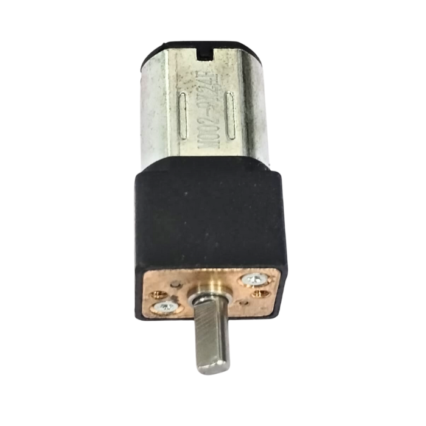<figcaption>N20 family example, unavailable ₹225 Robocraze listing; choose measured alternative. <a href="https://robocraze.com/products/robocraze-dc6v-100rpm-gm12-n20-miniature-gear-motor-with-metal-gear">Photo / listing source</a></figcaption></figure>
<figure>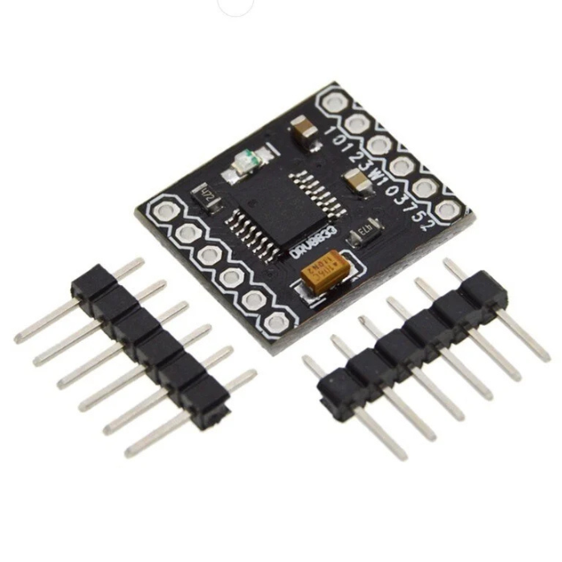<figcaption>DRV8833 module, C03. Carrier/chip/thermal rating must be checked. <a href="https://robocraze.com/products/drv8833-2-channel-dc-motor-driver">Photo / listing source</a></figcaption></figure>
<figure>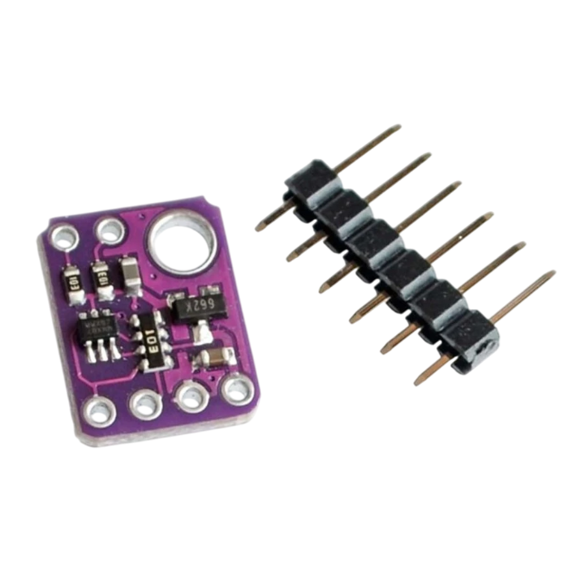<figcaption>VL53L0X breakout, C07/R12. <a href="https://robocraze.com/products/vl53l0x-laser-ranging-sensor">Photo / listing source</a></figcaption></figure>
<figure>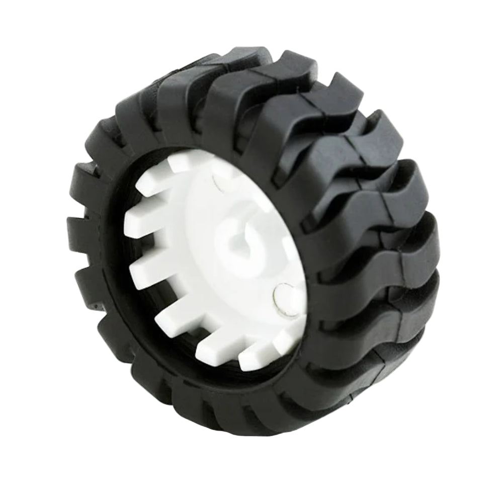<figcaption>44 mm N20 wheel, C02; use actual diameter in CAD. <a href="https://kitsguru.com/products/car-wheel-tyre-44mm-n20-dc-gear-motor-wheel">Photo / listing source</a></figcaption></figure>
<figure>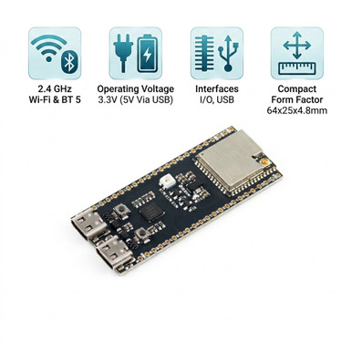<figcaption>ESP32-S3 DevKit, C04/R06; selected variant dimensions govern mount. <a href="https://evelta.com/7semi-esp32-s3-devkitc-1-esp32-s3-wroom-wi-fi-bluetooth-5-ble-development-board/">Photo / listing source</a></figcaption></figure>
<figure>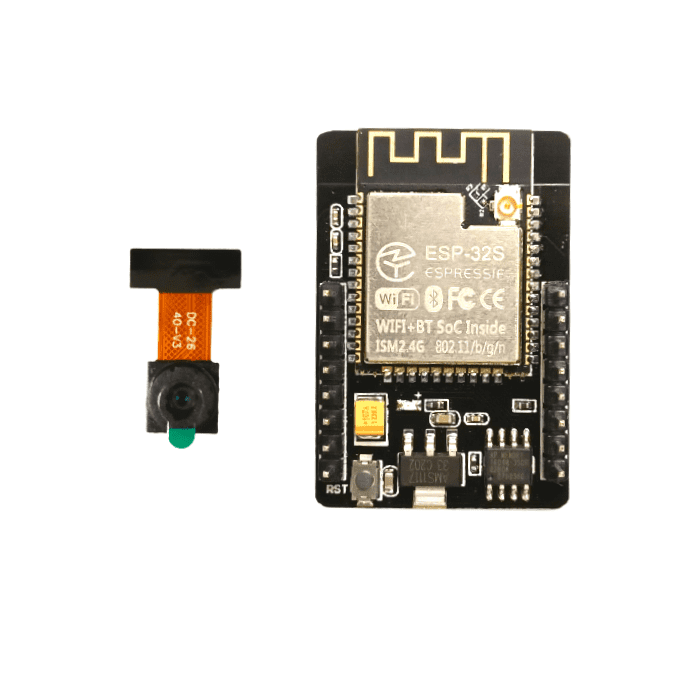<figcaption>ESP32-CAM C05; photo/listing may show different camera revision. Confirm delivered sensor. <a href="https://robocraze.com/products/esp32-camera-module">Photo / listing source</a></figcaption></figure>
<figure>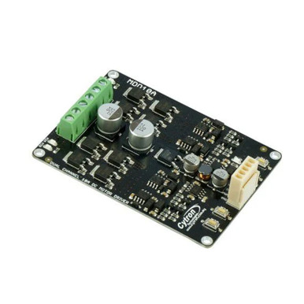<figcaption>Cytron MDD10A, R05; two boards give four independent channels. <a href="https://evelta.com/mdd10a-10amp-5v-30v-dc-motor-driver-2-channels/">Photo / listing source</a></figcaption></figure>
<figure>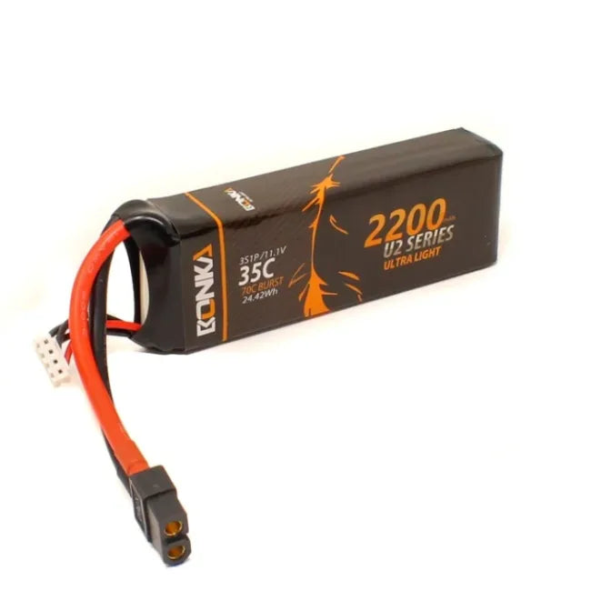<figcaption>Bonka 2200 mAh 3S battery, R07; lower-cost/shorter-runtime chemistry change. <a href="https://robocraze.com/products/bonka-2200mah-35c-3s1p-11-1v-lipo-battery">Photo / listing source</a></figcaption></figure>
<figure>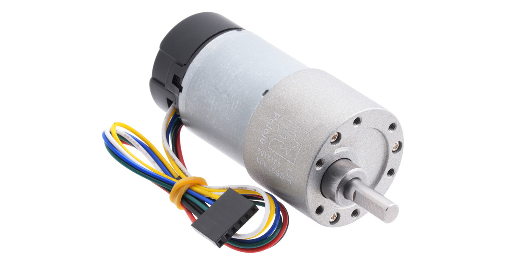<figcaption>Pololu #4755 premium alternative/reference, not the budget JGB37 motor. <a href="https://www.pololu.com/product/4755">Photo / listing source</a></figcaption></figure>
<figure>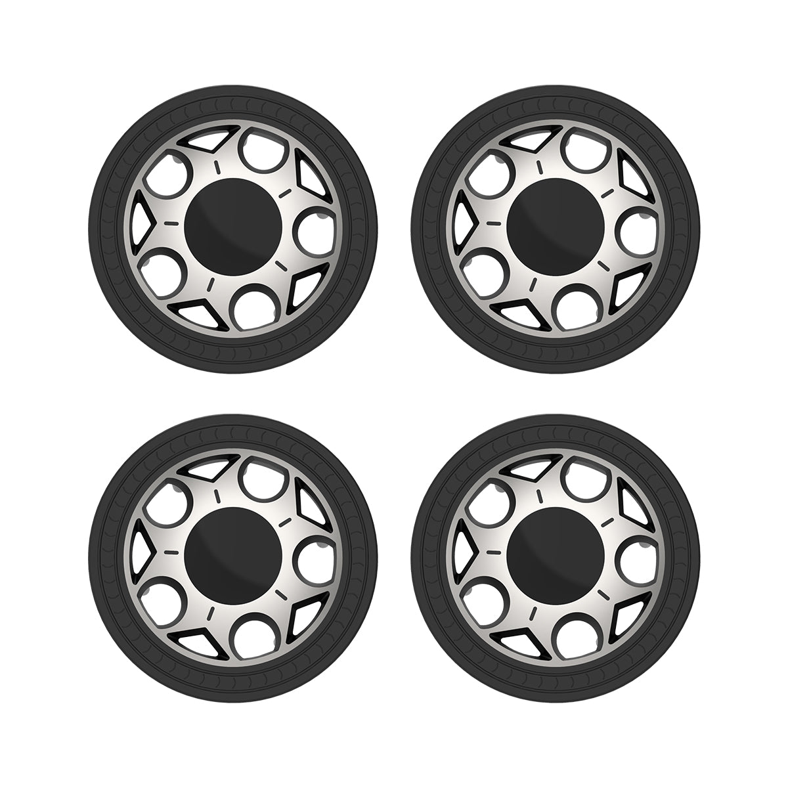<figcaption>Hiwonder 100 mm wheel, illustrative premium alternative; not priced into ₹250 wheel allowance. <a href="https://www.hiwonder.com/products/100mm-high-load-bearing-and-wear-resistant-tire">Photo / listing source</a></figcaption></figure>
<figure>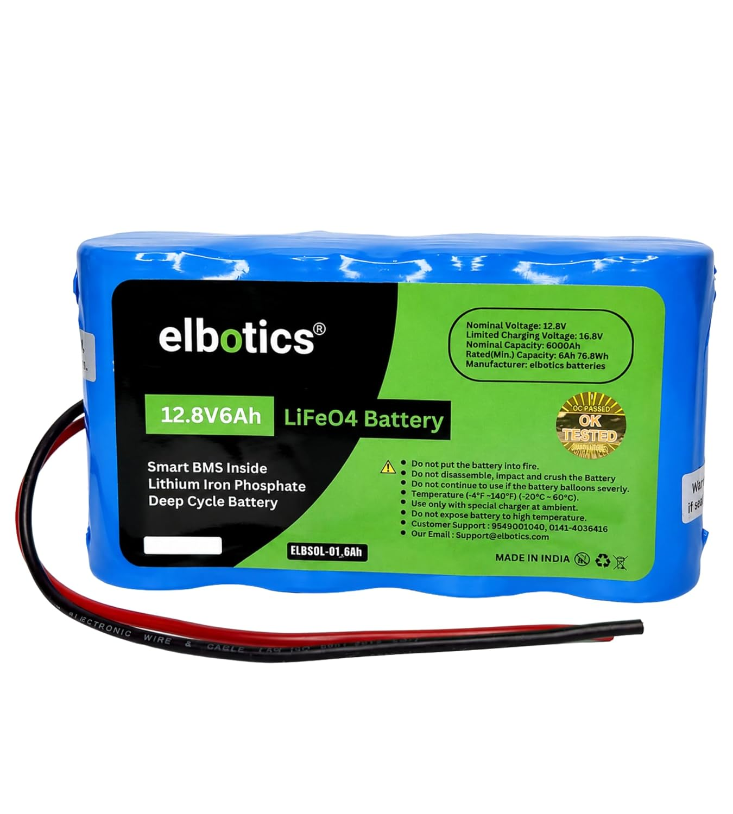<figcaption>ELBOTICS 6 Ah candidate: current/BMS/dimensions not documented enough for approval. <a href="https://elbotics.com/products/12-8v-6ah-lifepo4-battery-smart-bms-76-8wh">Photo / listing source</a></figcaption></figure>
<figure>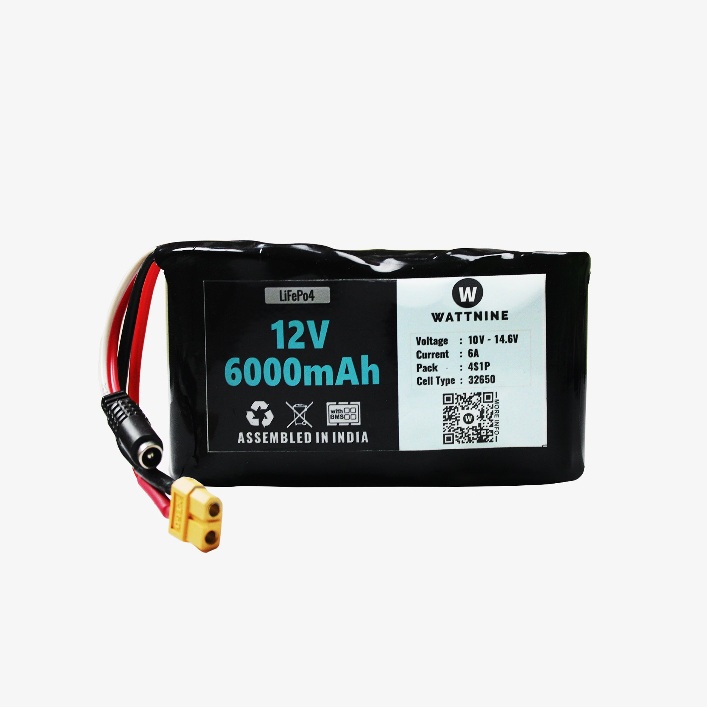<figcaption>WATTNINE 6 Ah candidate: only 6 A continuous; rejected as an unrestricted four-motor swap. <a href="https://quartzcomponents.com/products/12v-6ah-lithium-battery-lifepo4-battery">Photo / listing source</a></figcaption></figure></div>

## Fabrication and printed component inventory

All named mechanical modules are accounted for, including inactive modules and optional parts. Quantities represent pieces, **not export-file count**. `assembly` wrappers are visualization/export helpers and are not physical components. Camera, sensor, regulator, driver, switch and power-distribution brackets missing from the current CAD must be designed as part of final integration.

| Car | Module / component | Qty | Material / source | Manufacturing note |
|---|---|---:|---|---|
| Compact | base_plate | 1 | PETG | 150×105; currently z-shifted; fix before printing |
| Compact | n20_motor_mount | 4 | PETG or matched metal/plastic bracket | Rebuild cavity, flange and clamp for purchased motor |
| Compact | wheel | 4 | Purchase rubber wheel preferred | Printed option only; not additional to C02 |
| Compact | wheel_hub_adapter | 4 | Purchase compatible D wheel / redesign | Optional only; existing split adapter unusable |
| Compact | battery_tray | 1 | PETG | Add floor/straps and purchased pack dimensions |
| Compact | esp32_tray | 1 | PETG | Replace with selected board carrier |
| Compact | camera_mount | 1 | PETG | Replace with forward camera-specific holder |
| Compact | camera_front_mount | 0 | PETG option | Defined but inactive; no wrapper; use instead of another camera bracket |
| Compact | tof_sensor_bar | 1 | PETG | Replaces bar with three actual angled brackets or carries three boards |
| Compact | top_deck / top_cover | 1 | PETG | One identical part; alias is not a second cover |
| Compact | standoffs | 4 | Metal/nylon or PETG | Module exports four at once; do not print four copies of four |
| Compact | front_bumper | 1 | TPU/PETG | Move to X front; add tabs/clearance |
| Rugged | side_rail | 2 | Aluminium actual profile | ~330 mm preliminary cut length; need joint drawing |
| Rugged | cross_member | 2 | Aluminium actual profile | Across width; ~250 mm source length only after joint design |
| Rugged | electronics_tray | 1 | PETG/metal | 205×135×8 baseline; supports missing |
| Rugged | battery_tray | 1 | PETG/metal | 220×100×12 baseline; roof must become floor |
| Rugged | pi5_mount | 1 | PETG | Upgrade only; M2.5 carrier and cooler clearance |
| Rugged | esp32_mount | 1 | PETG | 65×42×6 baseline; selected board cradle |
| Rugged | motor_mount | 4 | Metal bracket preferred | 62×62×8 source plate replaced by real L brackets |
| Rugged | wheel_bearing_block | 4 | PETG/metal option | Do not build until bearing/axle architecture frozen |
| Rugged | wheel | 4 | Purchased rubber tyre | 100×32 baseline; update if 90 mm choice |
| Rugged | wheel_hub | 4 | Metal | Omit separate hub if purchased wheel includes proper hub |
| Rugged | camera_mount | 1 | PETG | Upgrade only, board-specific forward mount |
| Rugged | tof_bracket | 1 | PETG | 140×18×12 baseline; one/three boards properly aimed |
| Rugged | lidar_plate | 1 | PETG/aluminium | Upgrade only; 110×110×8 grid not final scanner interface |
| Rugged | lidar_mast | 1 | Short braced tube preferred | Upgrade only; source 38×38×120 has blind bore/detachment |
| Rugged | bumper | 2 | TPU / aluminium with foam | 330×24×28 baseline; current positioning collides with wheels |
| Rugged | side_panel | 2 | Thin PETG sheet/print | Optional; actual generated width15 despite target5 |

Use PETG for general chassis/module prototypes, TPU for optional tyres/bumpers, and aluminium for the rugged primary structure. ASA needs a suitable printer/enclosure. The initial document's 0.2 mm layers, 5 perimeters and 35–50% infill are only starting settings; mounting strength depends on orientation and load path. Reserve material for fit coupons. Long 330 mm rails/bumper parts exceed many 220 mm print beds, so fabricate structural rails in metal and segment optional bumpers with real joining features if necessary. The rugged overall envelope is about **400×332 mm**, larger than its intended structural footprint; choose printer/fabrication from individual part sizes.

## CAD findings

Read all blockers before purchasing mount-specific parts. Each entry gives a source location, observation and correction; CSV contains the same findings for tracking. Source links are relative to this local report; the `:line` label identifies the exact source even if your browser does not scroll to `#L` fragments in local SCAD files.

### Compact SCAD findings

### C-A01 · Blocker · Base is shifted upward, causing negative ground clearance

Evidence type: **Confirmed source defect**. Source: [01_Cute_N20_4WD/cute_rover_complete.scad:63](../01_Cute_N20_4WD/cute_rover_complete.scad#L63).

rounded_box(center=true) centres only X/Y and starts at Z=0. Additional BASE_T/2 makes base Z=2..6. Wheel bottom=26.5−22.5=4; underside is 2 mm below wheel ground plane.

**Correction:** Place base at Z=0..4; choose ground clearance e.g. 5–8 mm and compute shaft Z = wheel radius − clearance with base datum 0. Rebuild motor/deck constraints together.

### C-A02 · Blocker · Base mounting holes are blind

Evidence type: **Confirmed source defect**. Source: [01_Cute_N20_4WD/cute_rover_complete.scad:69](../01_Cute_N20_4WD/cute_rover_complete.scad#L69).

Hole cutter Z=−1..5; base Z=2..6 leaves a 1 mm roof.

**Correction:** Normalize base origin and use cuts extending past both faces.

### C-A03 · Major · Base cable slots cut only lower face

Evidence type: **Confirmed source defect**. Source: [01_Cute_N20_4WD/cute_rover_complete.scad:73](../01_Cute_N20_4WD/cute_rover_complete.scad#L73).

Centred height-6 cube translated Z=−1 gives −4..2; base begins at 2, so only coplanar contact, no useful through slot.

**Correction:** Use a full-thickness slot cutter centred at true base midpoint plus epsilon.

### C-A04 · Blocker · Battery tray is a bottomless ring

Evidence type: **Confirmed source defect**. Source: [01_Cute_N20_4WD/cute_rover_complete.scad:162](../01_Cute_N20_4WD/cute_rover_complete.scad#L162).

Tray Z=0..7; centred void translated Z=3 has Z=−1..7, removing the entire floor.

**Correction:** Add 2–3 mm floor, height matching pack, retaining lips, two strap slots and cable exit.

### C-A05 · Major · Tray screw holes occupy cavity instead of proper mounting tabs

Evidence type: **Confirmed source defect**. Source: [01_Cute_N20_4WD/cute_rover_complete.scad:163](../01_Cute_N20_4WD/cute_rover_complete.scad#L163).

Hole centres ±29/±15 are inside 62×32 opening (±31/±16), cutting only edge fragments.

**Correction:** Add tabs outside battery cavity with bolt-head/nut clearance; choose holes shared by chassis.

### C-A06 · Blocker · Standoffs miss the deck and base holes

Evidence type: **Confirmed source defect**. Source: [01_Cute_N20_4WD/cute_rover_complete.scad:219](../01_Cute_N20_4WD/cute_rover_complete.scad#L219).

Standoffs Z=4..36; deck underside=38, so 2 mm gap. Their XY ±50/±30 do not match base grid ±60/±30/0 × ±35/0.

**Correction:** Tie four base/deck holes to one shared array and derive spacer length from mating surfaces.

### C-A07 · Blocker · Deck centre opening leaves a roof

Evidence type: **Confirmed source defect**. Source: [01_Cute_N20_4WD/cute_rover_complete.scad:206](../01_Cute_N20_4WD/cute_rover_complete.scad#L206).

Centred height-5 cutter at Z=37 reaches only Z=39.5; deck Z=38..41 leaves 1.5 mm roof.

**Correction:** Cut through Z=38..41 plus epsilon; add protected wire edges.

### C-A08 · Blocker · Wheels overlap chassis sides

Evidence type: **Confirmed source defect**. Source: [01_Cute_N20_4WD/cute_rover_complete.scad:260](../01_Cute_N20_4WD/cute_rover_complete.scad#L260).

Wheel tyre inner Y=58.5−7=51.5, base edge=52.5, giving 1 mm lateral intrusion. At wheel low arc Z=4..6 this is physical solid intersection.

**Correction:** Position wheel from motor shaft engagement/offset and ≥1–2 mm assembled moving clearance, then re-check entire rotation.

### C-A09 · Blocker · Gearbox intersects wheel hub and shaft engagement is incomplete

Evidence type: **Confirmed source defect**. Source: [01_Cute_N20_4WD/cute_rover_complete.scad:117](../01_Cute_N20_4WD/cute_rover_complete.scad#L117).

Right motor centre Y=42.5; gearbox Y=55..61. Wheel centre=58.5, integral hub Y=50.5..66.5 with Ø3.2 bore. Ø12 gearbox occupies that hub bore region. Shaft Y=61..69 gives only 5.5 mm engagement within 16 mm integral hub.

**Correction:** Use exact motor face-to-shaft dimensions and actual bought wheel hub depth; resolve gearbox/hub collision before print.

### C-A10 · Major · N20 cavity models a cylinder instead of rectangular motor

Evidence type: **Motor fit risk; exact profile unverified**. Source: [01_Cute_N20_4WD/cute_rover_complete.scad:90](../01_Cute_N20_4WD/cute_rover_complete.scad#L90).

N20_BODY_H=10 is unused. 12×10 rectangular body diagonal is 15.62 mm; largest cylindrical cavity is Ø13.5. A full rectangular envelope cannot fit; actual rounded-can fit needs measurement.

**Correction:** Model rounded rectangular can/gearbox profiles, tolerances and retaining clamp from measured motor.

### C-A11 · Major · Mount insertion cut is asymmetric on the wrong local axis

Evidence type: **Confirmed source defect**. Source: [01_Cute_N20_4WD/cute_rover_complete.scad:98](../01_Cute_N20_4WD/cute_rover_complete.scad#L98).

Cut cube spans X=−16..0, Y=−22..0; every mount uses same transform, despite comment saying mirror for opposite side.

**Correction:** Design insertion access in shaft-side/inward direction, explicitly mirror/clamp left and right variants.

### C-A12 · Blocker · Motor mounts have no working chassis fastening/retention

Evidence type: **Confirmed source defect**. Source: [01_Cute_N20_4WD/cute_rover_complete.scad:102](../01_Cute_N20_4WD/cute_rover_complete.scad#L102).

Two local screws ±10 map to X=±42/±62,Y=±42.5; base grid has neither. Cutter stops Z=10 in mount Z=4..29; no defined accessible screw head/nut or motor clamp.

**Correction:** Add foot/flange, shared base holes, head/nut pockets, clamp screws and cable clearance.

### C-A13 · Blocker · Wheel adapter splits into two disconnected halves

Evidence type: **Confirmed source defect**. Source: [01_Cute_N20_4WD/cute_rover_complete.scad:151](../01_Cute_N20_4WD/cute_rover_complete.scad#L151).

Full-height 1.2 mm slot crosses entire hub diameter. Axial holes at X=±5 do not join the halves radially; wheel has no matching bolt holes or adapter pocket.

**Correction:** Prefer purchased D-shaft wheel; otherwise closed slotted clamp with cross bolt and wheel bolt/pocket interface.

### C-A14 · Major · Round bore has no torque lock

Evidence type: **Confirmed source defect**. Source: [01_Cute_N20_4WD/cute_rover_complete.scad:136](../01_Cute_N20_4WD/cute_rover_complete.scad#L136).

Ø3.2 wheel / Ø3.25 adapter on Ø3 D shaft has no D flat, radial set screw or designed interference; adapter omitted from assembly.

**Correction:** Use D-shaped bore or metal clamping hub and axial retention; do not assume loose round bore transmits torque.

### C-A15 · Major · Bumper is detached and projects into wheel envelope

Evidence type: **Confirmed source defect**. Source: [01_Cute_N20_4WD/cute_rover_complete.scad:243](../01_Cute_N20_4WD/cute_rover_complete.scad#L243).

Bumper Y=−61.5..−53.5 versus base minimum Y=−52.5 gives 1 mm gap. Its X width overlaps side wheel positions at the bumper Z span.

**Correction:** Move actual front to chassis X end, add bolt tabs and swept wheel clearance; evaluate TPU option.

### C-A16 · Major · Sensors/bumper labelled front are on lateral edge

Evidence type: **Confirmed source defect**. Source: [01_Cute_N20_4WD/cute_rover_complete.scad:227](../01_Cute_N20_4WD/cute_rover_complete.scad#L227).

Length/front-rear declared X, wheel shafts along Y, so rolling direction is ±X. Camera/ToF/bumper are on −Y (left/right side).

**Correction:** Adopt one axis convention and move/aim front sensors at −X or redefine all drivetrain coordinates consistently.

### C-A17 · Major · Camera fixture floats and orientation is unresolved

Evidence type: **Confirmed source defect**. Source: [01_Cute_N20_4WD/cute_rover_complete.scad:291](../01_Cute_N20_4WD/cute_rover_complete.scad#L291).

camera_mount bottom Z=42; deck top=41 gives 1 mm gap. Horizontal 36×24 slot fixture is not actual camera PCB pattern; camera_front_mount exists but is never called.

**Correction:** Use camera-specific forward bracket with shared holes, adjustment, lens opening and ribbon/connector clearance.

### C-A18 · Major · ESP tray fastening pattern does not match deck

Evidence type: **Confirmed source defect**. Source: [01_Cute_N20_4WD/cute_rover_complete.scad:283](../01_Cute_N20_4WD/cute_rover_complete.scad#L283).

Tray holes translate to X=−1/45,Y=0/24; deck has only four ±50/±30 holes and partial centre opening. Tray rests on deck without fasteners.

**Correction:** Add carrier mounting holes independent from actual board holes and model underside solder/header clearance.

### C-A19 · Major · ToF bar has circular apertures but no PCB interface

Evidence type: **Confirmed source defect**. Source: [01_Cute_N20_4WD/cute_rover_complete.scad:188](../01_Cute_N20_4WD/cute_rover_complete.scad#L188).

Three Ø8 holes along Z do not define forward pointing PCBs; no breakout dimensions, M2 holes, left/right angle or chassis tab matches.

**Correction:** Create three named angled PCB brackets from selected sensor drawings; keep optics clear of printed walls.

### C-A20 · Major · Battery tray height depends on erroneous base datum

Evidence type: **Integration gap**. Source: [01_Cute_N20_4WD/cute_rover_complete.scad:275](../01_Cute_N20_4WD/cute_rover_complete.scad#L275).

Current tray bottom Z=6 touches erroneous base top=6, but holes do not match; if base-origin fix is made alone it introduces a 2 mm gap. Capacity/type dimensions absent.

**Correction:** Constrain tray bottom to corrected base top, fit exact pack including connector and straps; do not change only one Z constant.

### C-A21 · Minor · Wheel tread comment and production thickness disagree

Evidence type: **Documentation drift**. Source: [01_Cute_N20_4WD/cute_rover_complete.scad:139](../01_Cute_N20_4WD/cute_rover_complete.scad#L139).

Comment says six grooves; loop 0:30:330 creates twelve. WHEEL_W=14 versus design document 12; deck 38 versus document 42–45.

**Correction:** Use one dimensional source and update prose/counts; design tread/material against actual tyre.

### C-A22 · Major · Individual exports retain assembly Z transforms

Evidence type: **Confirmed source defect**. Source: [01_Cute_N20_4WD/cute_rover_complete.scad:239](../01_Cute_N20_4WD/cute_rover_complete.scad#L239).

top_cover exports at Z=38, bumper at Z=10; wheels/hub span negative Z; standoffs export four positioned parts.

**Correction:** Separate local printable geometry from placement transforms; normalise each printable part to Z≥0 and document copies.

### Rugged SCAD findings

### R-A01 · Blocker · Crossmembers do not cross the chassis

Evidence type: **Confirmed source defect**. Source: [02_Rugged_37D_Future_Proof/rugged_rover_complete.scad:292](../02_Rugged_37D_Future_Proof/rugged_rover_complete.scad#L292).

Both 250×24 members have length along X and are at Y=±55. Rails lie at ±125. Crossmember Y edge=67; rail inner edge=111 leaves 44 mm gap.

**Correction:** Rotate crossmembers 90° about Z, place at selected X positions, create four joints and matched holes/angle brackets.

### R-A02 · Blocker · Motors, motor plates, hubs and bearings absent from assembly

Evidence type: **Confirmed source defect**. Source: [02_Rugged_37D_Future_Proof/rugged_rover_complete.scad:315](../02_Rugged_37D_Future_Proof/rugged_rover_complete.scad#L315).

assembly calls only wheels. motor_mount, motor_placeholder, wheel_hub and wheel_bearing_block are defined but unused. Wheels have no physical connection to frame.

**Correction:** Add four measured motors, face planes, brackets, hubs, shafts and fixation; model optional bearing supports only if actually used.

### R-A03 · Blocker · 37D hole circle is wrong

Evidence type: **Confirmed source defect**. Source: [02_Rugged_37D_Future_Proof/rugged_rover_complete.scad:26](../02_Rugged_37D_Future_Proof/rugged_rover_complete.scad#L26).

Six 60° holes at R=17.9 create 17.9 mm neighbour spacing. Stated reference is 15.5 mm neighbours / Ø31 circle, so R must be 15.5. MOTOR_HOLE_NEIGHBOR unused.

**Correction:** Use purchased-motor measured PCD/offset/pattern, not generic equivalence; for published Pololu drawing set R=15.5 and correct plate opening.

### R-A04 · Blocker · Correcting hole circle alone breaks screw seats

Evidence type: **Confirmed source defect**. Source: [02_Rugged_37D_Future_Proof/rugged_rover_complete.scad:135](../02_Rugged_37D_Future_Proof/rugged_rover_complete.scad#L135).

Current central opening radius=15; corrected M3 clearance radius 1.7 around R=15.5 extends inward to 13.8, overlapping opening by 1.2 mm.

**Correction:** Reduce opening to actual shaft/pilot-boss clearance with adequate material around each screw and washer; check reference pilot dimensions.

### R-A05 · Blocker · Motor plate has no suitable frame foot/orientation

Evidence type: **Confirmed source defect**. Source: [02_Rugged_37D_Future_Proof/rugged_rover_complete.scad:131](../02_Rugged_37D_Future_Proof/rugged_rover_complete.scad#L131).

Plate is local XY, normal Z, but wheel shafts are Y. No L foot, rotated location or chassis mating pattern.

**Correction:** Use metal L-bracket with vertical face normal Y, finite foot and matched frame holes; reserve screw-tool access.

### R-A06 · Blocker · Wheel intersects rails and bumpers

Evidence type: **Confirmed source defect**. Source: [02_Rugged_37D_Future_Proof/rugged_rover_complete.scad:316](../02_Rugged_37D_Future_Proof/rugged_rover_complete.scad#L316).

Wheel Y=134..166 overlaps side rail Y=111..139 by 5 mm; at X near ±150,Z=0..24 wheel solid crosses rail. Bumpers Y=±138..162,Z=20..48 overlap wheels too.

**Correction:** Increase track from actual frame/shaft/hub/tyre offsets or cut/reposition members; add dynamic clearances and redefine front bumpers at X ends.

### R-A07 · Blocker · Zero frame underside ground clearance

Evidence type: **Confirmed source defect**. Source: [02_Rugged_37D_Future_Proof/rugged_rover_complete.scad:290](../02_Rugged_37D_Future_Proof/rugged_rover_complete.scad#L290).

Rails start Z=0; wheel bottom=50−50=0. Structure sits on ground plane.

**Correction:** Specify ≥20–30 mm provisional clearance for this terrain aim and tie rail/motor locations to it; validate payload/load and actual obstacle height.

### R-A08 · Major · Declared structural footprint is not model-controlled

Evidence type: **Confirmed source defect**. Source: [02_Rugged_37D_Future_Proof/rugged_rover_complete.scad:15](../02_Rugged_37D_Future_Proof/rugged_rover_complete.scad#L15).

BASE_L=360, BASE_W=290 and BASE_T=5 are unused. Rail length 330, outer width 278; bumpers to Y±162; wheels span X±200,Y±166.

**Correction:** Derive member lengths, wheelbase, track and bumper positions from parameters; label structural footprint separately from 400×332 overall envelope.

### R-A09 · Blocker · Battery tray has a roof rather than an open top

Evidence type: **Confirmed source defect**. Source: [02_Rugged_37D_Future_Proof/rugged_rover_complete.scad:298](../02_Rugged_37D_Future_Proof/rugged_rover_complete.scad#L298).

Tray local Z=0..12; centred void Z=−8..8 removes bottom to 8, leaving top slab Z=8..12. Battery cannot drop into it from above.

**Correction:** Start cavity above a solid floor and cut out past top; resize exact battery, add straps, lips and tabs.

### R-A10 · Major · Battery mounting holes are in roof over cavity

Evidence type: **Confirmed source defect**. Source: [02_Rugged_37D_Future_Proof/rugged_rover_complete.scad:91](../02_Rugged_37D_Future_Proof/rugged_rover_complete.scad#L91).

Centres ±95/±35 lie inside cavity ±100/±40 and drill roof. No deck/shared frame bolt pattern or battery restraint.

**Correction:** Place mounting tabs outside cavity, grounded to supported deck; keep fasteners clear of cell casing.

### R-A11 · Blocker · Electronics and compute decks have no supports

Evidence type: **Confirmed source defect**. Source: [02_Rugged_37D_Future_Proof/rugged_rover_complete.scad:296](../02_Rugged_37D_Future_Proof/rugged_rover_complete.scad#L296).

Electronics bottom=35 vs rails top=24 gives 11 mm gap. Battery bottom=48 vs electronics top=43 gives 5 mm gap. Pi/ESP mounts bottom=60 with no defined supported connection.

**Correction:** Add posts at matching holes and explicit load path; put heavy battery low, compute above with airflow and service access.

### R-A12 · Major · Electronics cable channels remain capped

Evidence type: **Confirmed source defect**. Source: [02_Rugged_37D_Future_Proof/rugged_rover_complete.scad:81](../02_Rugged_37D_Future_Proof/rugged_rover_complete.scad#L81).

Height-12 centred cube at Z=−1 reaches Z=5; tray thickness=8 leaves 3 mm roof.

**Correction:** Make real through channels with grommet/strain relief or label intentionally blind channels and route accordingly.

### R-A13 · Major · Pi ventilation opening remains capped

Evidence type: **Confirmed source defect**. Source: [02_Rugged_37D_Future_Proof/rugged_rover_complete.scad:111](../02_Rugged_37D_Future_Proof/rugged_rover_complete.scad#L111).

Same centred cube reaches Z=5 in 8 mm plate, leaving 3 mm plastic over supposed opening.

**Correction:** Through cut and validate Pi underside clearance, airflow, cooler and connector access.

### R-A14 · Blocker · LiDAR mast is above and detached from plate

Evidence type: **Confirmed source defect**. Source: [02_Rugged_37D_Future_Proof/rugged_rover_complete.scad:308](../02_Rugged_37D_Future_Proof/rugged_rover_complete.scad#L308).

Plate Z=105..113; mast Z=160..280 gives 47 mm gap above plate rather than support beneath it. Plate itself unsupported.

**Correction:** Use short mast between supported deck and plate; model upper/lower flanges, hole patterns, cable exit and torsional restraint.

### R-A15 · Major · LiDAR cable bore is blind for almost half its height

Evidence type: **Confirmed source defect**. Source: [02_Rugged_37D_Future_Proof/rugged_rover_complete.scad:243](../02_Rugged_37D_Future_Proof/rugged_rover_complete.scad#L243).

Centred 125 mm bore at Z=−1 extends −63.5..61.5 in 120 mm mast, leaving top 58.5 mm solid. Screw holes reach only Z=19.

**Correction:** Bore full height plus epsilon and add upper fastening/cable relief; eliminate dangling mast until chosen sensor needs one.

### R-A16 · Blocker · Wheel hub cannot lock onto D shaft

Evidence type: **Confirmed source defect**. Source: [02_Rugged_37D_Future_Proof/rugged_rover_complete.scad:185](../02_Rugged_37D_Future_Proof/rugged_rover_complete.scad#L185).

Ø6.15 round bore on 6 mm D shaft, no D flat, radial screw or clamp; hub 20 mm long may exceed Pololu 16 mm shaft after plate loss.

**Correction:** Metal clamping hub matched to shaft and chosen wheel; budget shaft engagement, motor face plate and bearing spacing.

### R-A17 · Blocker · Wheel has no hub fastening pattern

Evidence type: **Confirmed source defect**. Source: [02_Rugged_37D_Future_Proof/rugged_rover_complete.scad:167](../02_Rugged_37D_Future_Proof/rugged_rover_complete.scad#L167).

Hub has four M4 holes on radius 15 at 45/135/225/315°, wheel only has Ø6.2 bore. No pockets/holes/axial retention marry them.

**Correction:** Add matching wheel holes/nut recesses or buy wheel+hub kit; locate clamping screw and verify all fasteners accessible.

### R-A18 · Major · Bearing cavity has no compatible shaft or retention design

Evidence type: **Confirmed source defect**. Source: [02_Rugged_37D_Future_Proof/rugged_rover_complete.scad:156](../02_Rugged_37D_Future_Proof/rugged_rover_complete.scad#L156).

22 mm OD cavity suggests 608 bearing (8 mm ID), whereas shaft is 6 mm. 16 mm-deep open bore has no shoulder/cap/fit tolerance.

**Correction:** If support needed, use chosen 6 mm-ID bearing such as 626 with changed OD19 seat, retain both races appropriately and provide axle/collar/alignment.

### R-A19 · Major · Rounded side panel violates its requested width

Evidence type: **Confirmed source defect**. Source: [02_Rugged_37D_Future_Proof/rugged_rover_complete.scad:266](../02_Rugged_37D_Future_Proof/rugged_rover_complete.scad#L266).

rounded_box 330×5 with r=5 requires at least 10 mm width, but centres at Y±2.5 produce overall width15 mm. Horizontal holes are centred Z=0, creating half holes at bottom.

**Correction:** Assert 2r≤min(x,y), reduce radius or use true thin panel geometry; move hole centres above edge with proper mounting tabs.

### R-A20 · Major · Camera/ToF and front bumpers on side, without mating tabs

Evidence type: **Confirmed source defect**. Source: [02_Rugged_37D_Future_Proof/rugged_rover_complete.scad:303](../02_Rugged_37D_Future_Proof/rugged_rover_complete.scad#L303).

Wheel axes Y mean driving X. Sensors at Y=−155/−160 and bumper Y=±150 are lateral; no actual PCB interfaces/support.

**Correction:** Move forward sensors to X end, add angled bracket patterns for exact boards and defined frame attachment.

### R-A21 · Major · Pi hole spacing correct but fastener/board interface incomplete

Evidence type: **Integration gap**. Source: [02_Rugged_37D_Future_Proof/rugged_rover_complete.scad:104](../02_Rugged_37D_Future_Proof/rugged_rover_complete.scad#L104).

58×49 nominal grid is plausible, but clearance uses M3=3.4; actual Pi board uses M2.5-compatible mounting. Board outline, hole offset, solder, cooler/cables not modelled.

**Correction:** Use manufacturer mechanical drawing, M2.5 spacers, real board offset and port cable clearance; mount never rests PCB on solid plate.

### R-A22 · Major · LiDAR grid is not a sensor-specific mount

Evidence type: **Integration gap**. Source: [02_Rugged_37D_Future_Proof/rugged_rover_complete.scad:224](../02_Rugged_37D_Future_Proof/rugged_rover_complete.scad#L224).

110×110 generic grid offers no chosen scanner mounting pattern, connector envelope or scan-plane clearance. Mast, battery/compute volumes omitted.

**Correction:** Pick scanner kit, import mechanical drawing, keep 360° optical plane unoccluded and vibration restrained.

### R-A23 · Major · SCAD solid rails differ from intended aluminium construction

Evidence type: **Integration gap**. Source: [02_Rugged_37D_Future_Proof/rugged_rover_complete.scad:50](../02_Rugged_37D_Future_Proof/rugged_rover_complete.scad#L50).

330×28×24 solid bars with vertical holes are not 2020 extrusion or angle profiles; no T-nuts, joints or cut/drill drawing.

**Correction:** Create actual metal frame drawings/BOM with section/material and connection hardware; do not simply print bars and assume rugged strength.

### R-A24 · Major · Motor placeholder does not establish a purchased-motor envelope

Evidence type: **Integration gap**. Source: [02_Rugged_37D_Future_Proof/rugged_rover_complete.scad:275](../02_Rugged_37D_Future_Proof/rugged_rover_complete.scad#L275).

Centred 65 mm cylinder plus partly overlapping 26.5 mm face and Ø6 shaft is illustrative; shaft offset, encoder and wire exits unmodelled. JGB37 and Pololu references differ.

**Correction:** Choose exact motor SKU, body/gearbox/encoder length, face pilot, eccentricity and harness envelope; do not mix motor families.

### STL, electrical and documentation findings

### S-A01 · Blocker · Compact STL is stale relative to current source

Evidence type: **Measured mesh/source mismatch**. Source: [01_Cute_N20_4WD/cute_rover_complete.stl:1](../01_Cute_N20_4WD/cute_rover_complete.stl#L1).

Existing bounds X −77.4263..150, Y −67.5..105, Z 0..48.9263; extents 227.4263×172.5×48.9263. Current source X envelope −75..75; tyres/hubs Y about −66.5..66.5, motor placeholder shafts extend to ±69. File mtime also older.

**Correction:** Archive existing STL as an unreleased historical artefact; regenerate separate parts only after corrected CAD is checked.

### S-A02 · Major · Existing STL has a nonmanifold edge

Evidence type: **Measured mesh defect**. Source: [01_Cute_N20_4WD/cute_rover_complete.stl:1](../01_Cute_N20_4WD/cute_rover_complete.stl#L1).

One edge from (−10,−16,24) to (10,−16,24) has four incident faces. No boundary edges; five vertex-connected components.

**Correction:** Fix source tangency/union responsible in original source if available; regenerated part meshes must have exactly two incident faces per edge.

### S-A03 · Major · Manufacturing exports incomplete

Evidence type: **Release gap**. Source: [MANIFEST.txt:1](../MANIFEST.txt#L1).

Only one STL exists, for old complete compact assembly. No rugged STL and no per-part STLs; assembly exports include nonprinted placeholders/unjoined/fused geometry.

**Correction:** Release explicit named part STLs/3MF, quantity/orientation table, source hash and dimensions; never print motor placeholders.

### S-A04 · Minor · Concept images referenced by documents are missing

Evidence type: **Documentation defect**. Source: [01_Cute_N20_4WD/Compact_4WD_Smart_Rover.md:1](../01_Cute_N20_4WD/Compact_4WD_Smart_Rover.md#L1).

compact_rover_top.svg and rugged_rover_top.svg do not exist; images/ at repository root is empty. Existing assembled PNG is a preview, not proof of fit.

**Correction:** Replace missing references with real current-source renders after CAD fixes and retain diagnostic drawings clearly labelled.

### S-A05 · Major · No complete electrical or pin assignment design

Evidence type: **Design gap**. Source: [02_Rugged_37D_Future_Proof/Rugged_Smart_4WD_Rover.md:1](../02_Rugged_37D_Future_Proof/Rugged_Smart_4WD_Rover.md#L1).

No schematic, selected board pin map, driver mounting, XSHUT/encoder level interface, wire routing or switch/power mounts in CAD.

**Correction:** Freeze hardware pin plan, supply branches, harness and failure-stop logic; list mounts for every purchased board.

### S-A06 · Major · Encoder “11-wire” claim appears to confuse pulse count with conductors

Evidence type: **Likely documentation error; seller confirmation needed**. Source: [02_Rugged_37D_Future_Proof/Rugged_Smart_4WD_Rover.md:1](../02_Rugged_37D_Future_Proof/Rugged_Smart_4WD_Rover.md#L1).

Rugged document calls the motor 11-wire. Manufacturer JGB37 example says 11 signals per motor revolution and shows six signal/power leads; selected listing live read blocked.

**Correction:** Delete blanket 11-wire assumption; require purchased motor pinout. Establish PPR vs quadrature counts and gear ratio experimentally.

### S-A07 · Major · 6 V N20 power baseline and driver peak rating are unresolved

Evidence type: **Electrical integration gap**. Source: [01_Cute_N20_4WD/Compact_4WD_Smart_Rover.md:1](../01_Cute_N20_4WD/Compact_4WD_Smart_Rover.md#L1).

Compact document proposes 2S battery straight into drivers; full charge is 8.4 V vs recommended 6 V motor. DRV8833 RMS differs by package and board cooling.

**Correction:** Use regulated motor rail with transient handling, or exact motor rated for selected rail; verify stall and current protection.

### S-A08 · Major · Original rugged battery can overvolt a 12 V motor

Evidence type: **Electrical integration gap**. Source: [02_Rugged_37D_Future_Proof/Rugged_Smart_4WD_Rover.md:1](../02_Rugged_37D_Future_Proof/Rugged_Smart_4WD_Rover.md#L1).

4S LFP approaches 14.6 V, ~22% above 12 V. Motor tolerance not established; brake regeneration and BMS trips unanalysed.

**Correction:** Verify motor permitted voltage or use suitable regulation/voltage selection. PWM duty reduction limits average drive but does not remove higher terminal pulses.

### S-A09 · Major · Rugged terrain/payload goals have no quantified validation

Evidence type: **Performance gap**. Source: [02_Rugged_37D_Future_Proof/Rugged_Smart_4WD_Rover.md:1](../02_Rugged_37D_Future_Proof/Rugged_Smart_4WD_Rover.md#L1).

No total mass, centre of gravity, slope target, traction coefficient, radial motor load or suspension/articulation calculation. A rigid four-wheel chassis can lose contact on uneven ground.

**Correction:** Set mass/slope/obstacle targets, model motor torque/load and tipping limits; test progressively. Treat terrain claims as targets, not verified capability.

### S-A10 · Major · BOM baseline omits practical integration purchases

Evidence type: **Procurement gap**. Source: [02_Rugged_37D_Future_Proof/Rugged_Smart_4WD_Rover.md:1](../02_Rugged_37D_Future_Proof/Rugged_Smart_4WD_Rover.md#L1).

No fixed camera programmer, Pi5-specific cable, level conversion, pack restraint, connectors/contact counts, regulator transients or exact hardware lengths.

**Correction:** Use revised BOM plus optional inventory below; fastener lengths remain conditional on corrected joints.

### S-A11 · Major · No print fit/tolerance or fabrication acceptance criteria

Evidence type: **Manufacturing gap**. Source: [RESEARCH_NOTES.md:1](../RESEARCH_NOTES.md#L1).

No printer clearances for shafts/bearing seats/heat-set inserts; no metal plate drawings/load tests. $fn segmentation is adequate for visuals, not proof of shaft fit.

**Correction:** Print bore/hole coupons, measure real motor/wheel, inspect F6 part mesh and slicer; record acceptance before full prints.

### S-A12 · Minor · Legacy Pololu reference is discontinued

Evidence type: **Verified sourcing drift**. Source: [RESEARCH_NOTES.md:1](../RESEARCH_NOTES.md#L1).

Research references #2826; manufacturer now marks obsolete and points to #4755, which is 100 RPM, not budget JGB 60 RPM.

**Correction:** Update documentation and differentiate reference drawing from recommended purchasable SKU.

## Compatibility details to freeze before ordering

### Motor, hub, wheel and frame

For **each motor SKU**, collect rated voltage, no-load/loaded RPM, reduction ratio, usable continuous torque, stall current at selected voltage, gearbox and can L/W/H, face PCD/pilot, shaft diameter/flat-depth/length, any shaft eccentricity, encoder board/cap and lead exits. A family name is not a manufacturing drawing. The Pololu drawing's 15.5 mm adjacent mounting spacing implies **R=15.5 mm for a regular six-hole hexagon**; `R=17.9` is wrong. The reference requires no more than 3 mm screw penetration into gearbox holes. Do not generalise that depth to a different vendor without its drawing. [Pololu mechanical drawing](https://www.pololu.com/file/0J1735/37d-metal-gearmotors-dimension-diagram.pdf)

For each wheel, require diameter, width, hub depth, axle bore shape/flat, offset, bolt pattern and fastening method. Compute **shaft engagement after bracket, pilot and hub placement**, then choose wheel Y from that mating geometry. Prefer metal locking hubs for the rugged car. A round printed clearance hole needs a separate torque and axial locking mechanism. Check tyre runout, rim clearance, full-rotation clearance, bolt-head clearance and motor wire clearance. Match mass/radial-load limits before adding bearings.

### Drivers, voltage and protected power

DRV8833 supports 2.7–10.8 V operating supply, but chip package ratings differ: the thermally enhanced packages support 1.5 A RMS/2 A peak per bridge under stated conditions; the PW package is 500 mA RMS. A carrier's thermal capability may be lower. Treat a seller's “2 A” as a peak claim until demonstrated. [TI DRV8833](https://www.ti.com/product/DRV8833)

The genuine MDD10A Rev2 supports 5–30 V, **10 A continuous and 30 A peak for 10 seconds per channel**, 3.3/5 V control and regenerative braking; it has no motor-supply reverse-polarity protection. A “13 A” seller sentence does not override the manufacturer. [Cytron MDD10A](https://www.cytron.io/p-10amp-5v-30v-dc-motor-driver-2-channels)

An alternative **four BTS7960/IBT-2 boards** costs less but uses one board per motor, takes more space and requires inspection of PCB terminals, logic buffers, heatsink and current-sense implementation. “43 A” in a module title is not a demonstrated continuous board current. Start with a conservative tested current and use enable pull-downs. It does not provide closed-loop encoder control by itself. [Robokits listing route](https://robokits.co.in/index.php?main_page=product_info&products_id=1859) has an indexed ₹307/in-stock snapshot; [Robocraze's alternative](https://robocraze.com/products/bts7960b-43a-h-bridge-motor-driver) has an indexed ₹316 but is sold out. Verify checkout GST and stock before using the ₹350 cap.

If the budget JGB37 encoder motor cannot be obtained, [Robokits RMCS-3012](https://robokits.co.in/motors/encoder-dc-servo/high-torque-12v-dc-encoder-motor/dc-12v-60rpm-high-torque-quad-encoder-motor) is a documented 12 V 60 RPM quadrature alternative, indexed at ₹1,500 each. Its 37 mm gearbox, offset 6 mm shaft, 30 mm shaft length, 87 mm body and 5 V encoder require new brackets/level conversion; advertised load current is up to 7.5 A, so redo stall/driver/fuse checks. Availability snapshots conflict between in stock and 45-day shipment. Four add at least ₹3,400 over the motor allowance and exceed the budget configuration. The [Rhino GB37 nonencoder alternative](https://robokits.co.in/motors/rhino-gb37-12v-dc-geared-motor/dc-geared-12v-motors/rhino-gb37-12v-60rpm-10.4kgcm-dc-geared-motor), indexed around ₹382, is the cheaper trade-off; it drops encoder speed control/odometry rather than retaining the full feature set.

Size motor branches from **measured and maker-specified stall/start current**, not nominal running current. For illustration only, the manufacturer-indexed JGB37-520B 12 V 60 RPM table reports about 2.3 A stall for one variant; all four would be 9.2 A at 12 V. That is not the confirmed EngineersToy motor. A Pololu #4755 instead lists 5.5 A per motor, so four would be 22 A. Driver, BMS, fuse, connectors and gauge must change accordingly. [JGB37 manufacturer reference](https://www.aslongdcmotor.com/photo/aslongdcmotor/document/26547/37mm%20Round%20Spur%20Gear%20Motor_PDF00.pdf), [Pololu alternative](https://www.pololu.com/product/4755)

Suggested initial power routes:

```text
COMPACT: 2S LiPo → fuse → DC main switch → distribution
           ├─ motor regulator 5.5–6 V + tested braking clamp → two DRV8833 → four N20
           └─ filtered 5 V regulator → S3 DevKit + camera board
                                        └─ 3.3 V-compatible ToF bus

RUGGED BUDGET: 3S LiPo → fuse → battery disconnect → distribution
                ├─ hardware drive-stop path → two MDD10A → four JGB motors
                └─ filtered 5 V regulator → S3 + verified encoder interface + ToF
                     └─ optional separate qualified Pi supply added later
```

Connect battery/motor returns at power distribution; keep sensor/encoder returns clear of motor current. Use reverse-polarity protection or a keyed checked harness. Do not place a single flyback diode directly across a bidirectional motor. Braking energy needs a return path; ordinary buck regulators often cannot sink current. Check rail overshoot, especially with a full battery or a BMS that disconnects. Suppression component values in the BOM are starting allocations, not a validated transient circuit.

### Controller and GPIO budget

| Function | Compact recommended two-board build | Rugged four-channel build |
|---|---:|---:|
| Motor controls | 8 GPIO for two-input DRV8833 control per motor | 8 GPIO for PWM + DIR per motor |
| Encoder inputs | 0 base; +8 if encoder upgrade | 8 |
| Sensor bus | 2 GPIO I²C | 2 GPIO I²C |
| XSHUT | 3 GPIO for three ToF | 0 required for one; 3 if expanded to three |
| Disable/stop monitor | At least 1, tied to defined hardware stop path | At least 1; more if driver/circuit requires |
| Battery sensing | 1 ADC-capable input for suitable divider or external monitor | 1 ADC-capable input or external cell monitor |
| Camera | Own separate camera board; no control GPIO consumed by camera on S3 | Upgrade camera on own board/Pi; exclude camera bus from motor pins |
| Pi link later | Optional | USB or UART pins planned; native USB reserves its pins |

The compact S3 needs about **14 general inputs/outputs plus one ADC**, the rugged base about **19 plus one ADC**. Those are resource budgets, not tested pin assignments. Check exact module flash/PSRAM occupied pins, USB pins, strapping pins and onboard LED. Use pull-downs on drive-enable/PWM so reset and boot cannot move wheels. The advertised 7Semi board exposes headers; the selected variant still needs a pinout review. [Espressif DevKit guide](https://docs.espressif.com/projects/esp-dev-kits/en/latest/esp32s3/esp32-s3-devkitc-1/user_guide_v1.1.html)

A Seeed XIAO S3 Sense has camera, microphone and SD functions that reserve/share pins. With camera streaming plus four independent DRV8833 channels, I²C and three XSHUT lines, a direct pin allocation is tight; use an I/O expander for static XSHUT or separate control board, and disable conflicting SD/microphone functions as needed. An I/O expander should not carry timing-critical motor PWM or quadrature signals. [Seeed pin map](https://wiki.seeedstudio.com/xiao_esp32s3_getting_started/)

### Encoders and sensors

For encoder wiring, require the actual motor's six-or-other-wire pinout. The JGB manufacturer example's **11 pulses/signals per motor revolution does not mean 11 wires**. If PPR=11 per channel, quadrature x4 and reduction=168, output counts are `11×4×168=7392`, only if those definitions and ratio match your unit. Rotate the wheel through one revolution and verify counts, direction and noise. Do not reuse Pololu's 64 CPR definition on a JGB motor. Use ESP32-S3 PCNT where appropriate and calibrate for the skid-steer effective track/slip. [Espressif PCNT](https://docs.espressif.com/projects/esp-idf/en/stable/esp32s3/api-reference/peripherals/pcnt.html)

The Pololu alternative needs encoder Vcc at least 3.5 V and produces outputs approximately up to Vcc, so 5 V encoder power requires a suitable 3.3 V input interface. For JGB variants, obtain the voltage/output type before wiring; do not infer pin colours across brands. Eight channels need eight conversions if outputs are push-pull 5 V. Establish common reference and route A/B away from motor leads.

VL53L0X uses I²C and programmable address with XSHUT. Three identical modules start at the same address; hold all off, enable/address one at a time, and repeat after every reset. Breakout board regulator/pull-ups matter: a bare sensor is not a 5 V module. Mount optics facing forward, angle side boards deliberately, and test in sunlight, on black surfaces and near shiny/transparent objects. Do not promise 2 m usable distance in every condition. [ST VL53L0X](https://www.st.com/en/imaging-and-photonics-solutions/vl53l0x.html)

### Pi/LiDAR upgrade

A Pi 5 should have a qualified mobile supply capable of its workload and USB peripherals. A 3 A supply can boot it but peripheral USB power is restricted; detecting a suitable 5 A supply raises the USB budget. A generic 5 A buck and passive USB-C lead do not automatically provide the correct supply negotiation. Include cooler, reliable storage, M2.5 carrier, proper Pi 5 camera cable, USB data cable and power scheme. [Official Pi power documentation](https://www.raspberrypi.com/documentation/computers/raspberry-pi.html#power-supply)

For LiDAR, confirm exact model revision, scan range/rate, Linux driver, USB interface, rated supply/current, footprint and height. Keep scan plane clear of Pi box, mast, camera and handles. RPLIDAR A1 is primarily a low-cost indoor mapping option; rugged outdoor use needs actual sunlight/terrain tests or a suitable outdoor-rated scanner. Validate IMU timestamps/calibration and four-wheel odometry before SLAM/Nav2. Defer model-specific software versions until the hardware/OS choice is frozen.

## Buying sequence and acceptance checks

1. **Fix geometry constraints first:** choose X front, Z ground/base convention, actual wheel/shaft alignment, battery floor and frame joints; add supported decks. Keep originals and make a reviewed revision.
2. **Buy one drivetrain sample per car:** motor, compatible wheel/hub and bracket. If seller cannot provide stall current, mounting drawing, encoder pinout and package contents, choose another supplier. Test motor dimensions before buying all four.
3. **Obtain pack and fabrication quotes:** exact battery drawing/current/BMS/connector, correct charger, printed part service if no printer, aluminium cut lengths/section and hole drawing. Keep a reserve inside ₹15,000.
4. **Print fit coupons:** rectangular motor cavity, shaft D bore/metal hub pocket, one motor bracket, one PCB mount, bolt/insert and optional bearing seats. Measure before final quantity printing.
5. **Render every individual part in OpenSCAD F6:** no warnings/undefined variables/empty geometry; no coplanar-only joints; slicer dimension/unit/orientation sanity check; manifold per-part STLs with source revision/hash.
6. **Bench-test power one motor at a time:** current-limited supply, polarity, 5 V stability, logic levels, current/temperature and brief controlled start-current checks. Avoid prolonged stalls. Verify all-four starts and worst skid turns within branch/fuse/BMS ratings.
7. **Test failsafe before wheels on ground:** boot/reset/offline command/USB disconnect must disable movement; per-cell low-voltage stop, emergency drive disable and recovery must work. Physical stop must work independently of Wi-Fi.
8. **Validate mechanical and terrain:** wheel spin clear of rails/bumper, no harness rub, pack restrained, all fasteners locked, no PCB contact with metal. Start unloaded on tile; then intended mass, grass and specified slope while logging current, temperature and wheel slip.

For slope sizing, set total mass `m`, wheel radius `r`, angle `θ` and estimated rolling resistance `Crr`. A first traction force is `F=m·g·(sinθ+Crr·cosθ)`. If four wheels share load, each needs at least `F·r/4` torque before drivetrain losses and acceleration/turning margin. Use **continuous rated torque**, not seller stall torque, for sustained hills. Centre-of-gravity height and track/wheelbase determine tipping; skid turns can need more current than straight driving.

Recommended tools already owned or acquired separately: digital caliper, multimeter, suitable current-limited bench supply/current meter, soldering iron, connector crimper or precrimped leads, hex drivers and drill/reamer for metal. Add their actual cost if purchasing them; neither car subtotal includes a printer, tools, computer or labour.

## Files and sources

The main reading version is [ROVER_REVIEW_AND_BOM.html](ROVER_REVIEW_AND_BOM.html); it includes offline photos, filterable tables and print-to-PDF support. The plain version is [ROVER_REVIEW_AND_BOM.md](ROVER_REVIEW_AND_BOM.md). Download [bom.csv](bom.csv), [design_findings.csv](design_findings.csv) and [fabrication_inventory.csv](fabrication_inventory.csv) for editing.

Buying links in each BOM row are direct product pages when verified, or **portal search routes** for generic hardware when a specific SKU is not frozen. Robu, Robocraze, Evelta, Zbotic, KitsGuru, Robokits and specialist hobby sellers are sourcing options, not endorsements of every listing. Mouser India / element14 India are alternative routes for genuine semiconductor/dev-board parts but usually cost more than generic module sellers. For aluminium and metric hardware, local fabrication/fastener shops can be cheaper and allow measuring before purchase.

Stock changed or conflicted between indexed pages and live JSON during this check. N20 Robocraze ₹225 is unavailable; camera JSON said available while cached page said sold out; VL53L0X JSON ₹126 differs from cached ₹123. All matching quantities/variants must be checked at checkout. No purchases were made.
